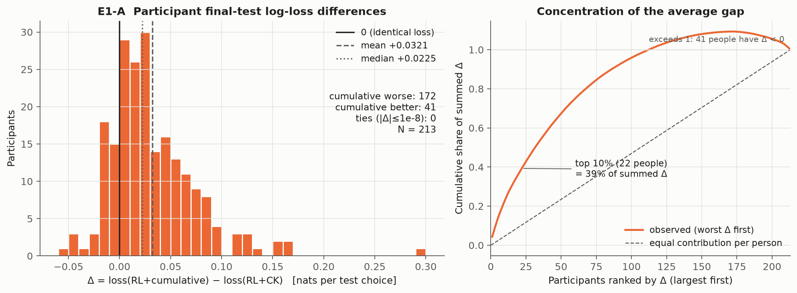
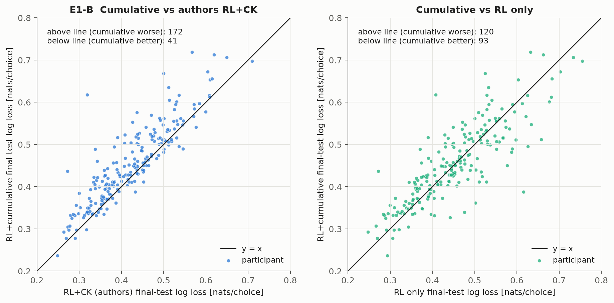
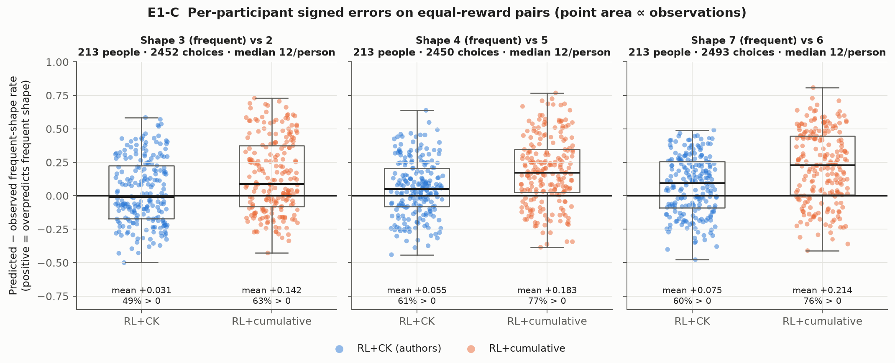
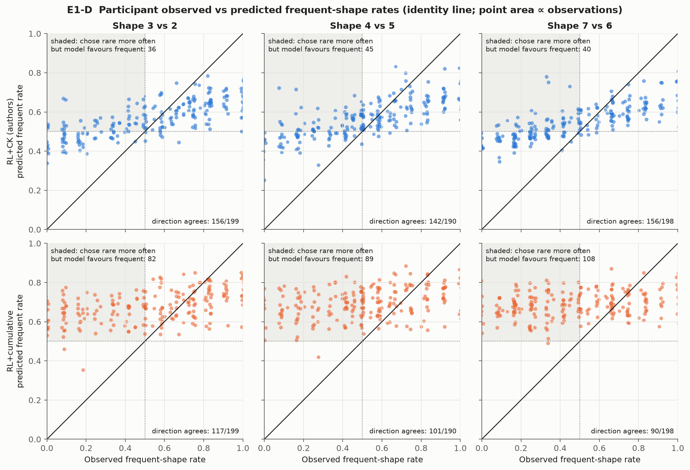
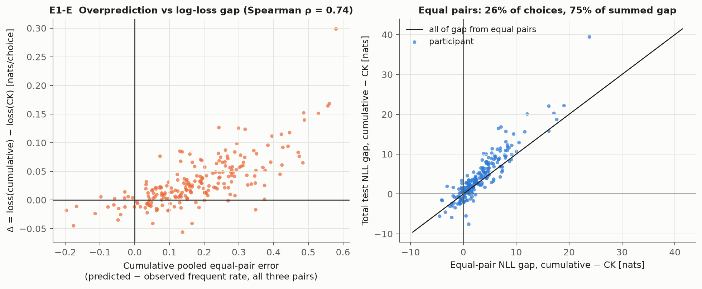
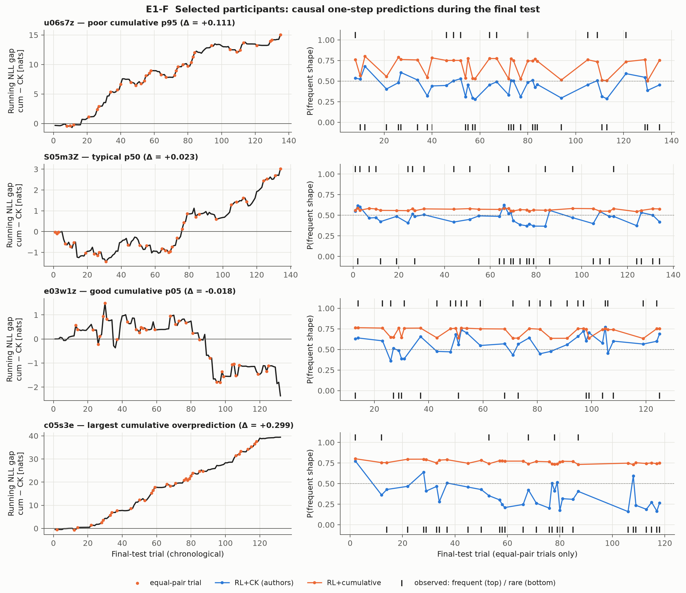

# Experiment 1 — Participant-level prediction-error diagnostics

> **Archived — historical comparator.** This experiment diagnosed the retired RL+cumulative model; its next-step suggestions are superseded by [research_direction.md](research_direction.md).

Diagnostic only: no model was refitted, no parameter/bound/update rule changed, no participant excluded, and final-test performance was not used to select or tune any model. Generated by `scripts/report_participant_errors.py` from saved results; numbers below are recomputed on every run. Sections D–E (after the marker) are hand-written interpretation and are preserved on regeneration.

## A. Research question

Why does our RL + cumulative choice-history model generalize worse to the final Reward Pairs test than the authors' RL + recency-weighted choice kernel (CK)? Specifically: are poor transfer and the pooled equal-reward overprediction widespread across participants, or concentrated in an identifiable subset?

## B. Methods

**Data.** `docs/human_history_results.json` (sha256 `1801637995a97f5e…`), primary variant **`released_code_intended`**, scoring pi = 0. 213 unique participants, 28,320 final-test choices. `paper_intended` rows are filtered out of every primary number and figure and appear only in the appendix.

**Models (as saved, unchanged).** RL only (authors model 3); RL+CK (authors model 19; JSON key `ck`); RL+cumulative (`H=C/N−0.5`, signed beta_H). Test predictions are causal one-step-ahead: Q frozen, history state updated after each observed test choice, parameters fixed from training.

**Loss sign convention.** `Δ_i = loss_cumulative,i − loss_CK,i` (mean nats per test choice). Positive = cumulative worse. The saved file stores the opposite (`reference − cumulative`); every participant value was sign-converted and checked against direct subtraction of the stored losses (|diff| ≤ 1e-12) and against the stored winner labels. Ties: |Δ| ≤ 1e-08 (the repository’s numerical tolerance). ±0.01 nats/choice is counted descriptively only.

**Equal-pair errors.** For pairs 2–3, 4–5, 6–7 the historically frequent member is 3, 4, 7. Per participant × pair × model: `observed = observed_frequent_count/n`, `predicted = predicted_frequent_sum/n`, `error = predicted − observed` (positive = overpredicts the frequent shape). The saved records already orient each trial to the frequent member whichever side it appeared on. Zero-observation records would yield undefined rates and are counted separately (there are none in this cohort).

**Noise reference.** With ~12 observations per participant and pair, individual rates are noisy. Two calibrated-model references are reported: (i) `z = (pred_sum − obs_count)/sqrt(n·p̄(1−p̄))`, whose binomial variance upper-bounds the Poisson-binomial variance of a calibrated model (so |z| is conservative); a calibrated model would give |z| > 1.96 for roughly 5% of people, split evenly by sign; (ii) the expected |observed − 0.5| that binomial noise alone would produce if the model’s mean predicted rate were true. Neither is a formal per-person test; no multiplicity correction is implied.

**Overprediction vs overconfidence.** *Directional* error is `predicted − observed` for the designated frequent shape. *Extremity* compares |predicted − 0.5| with |observed − 0.5| regardless of direction. A model can overpredict the frequent shape while being under-confident about the participant’s actual preference (e.g. predicting 0.65 frequent for someone who chose the rare shape 80% of the time).

**Aggregation.** Participant-weighted (each person equal) and trial-weighted (each choice equal) summaries are labelled separately. Pooled pair rates are observation-weighted sums, reconstructing the published table. Correlations are Spearman, descriptive, not causal.

## C. Results

### C0. Reproduction of established benchmark statistics

58/58 reproduction checks passed (participant count, better/worse/tied counts, mean/median Δ with sign flip, total NLL gap, trial- and participant-weighted log losses, pooled equal-pair n / observed / predicted / log loss for all three models; tolerance 1e-9, 1e-6 for summed nats). Failed checks: none.

| Model | Trial-weighted test log loss | Participant mean | Participant median |
| --- | --- | --- | --- |
| RL only | 0.4511 | 0.4511 | 0.4456 |
| RL+CK (authors) | 0.4221 | 0.4222 | 0.4218 |
| RL+cumulative | 0.4541 | 0.4542 | 0.4463 |

### C1. Analysis A — participant-level predictive performance





| Statistic (Δ = cum − CK, nats/choice) | Value |
| --- | --- |
| Mean (participant-weighted) | +0.03205 |
| Trial-weighted Δ (total NLL gap / choices) | +0.03202 |
| Median | +0.02251 |
| SD | 0.04349 |
| P5 / P25 / P75 / P95 | -0.0180 / +0.0042 / +0.0527 / +0.1128 |
| Min / max | -0.0562 / +0.2986 |
| Cumulative worse / better / tied | 172 / 41 / 0  (saved: 172 / 41 / 0) |
| Worse by > 0.01 / better by > 0.01 | 143 / 26 |
| Existing participant-bootstrap 95% CI of mean (sign-flipped, not resampled) | [+0.02637, +0.03801] |
| 10% trimmed mean | +0.02760 |
| Top 5% / 10% / 20% of people: share of summed Δ | 24.6% / 39.3% / 61.3% |
| Mean Δ after removing top 5% / 10% / 20% | +0.0255 / +0.0217 / +0.0155 |
| People accounting for half of the positive Δ mass | 37 of 172 positive |

Versus RL only, Δ_RL = cum − RL: mean +0.00310, median +0.00410, cumulative worse/better 120/93 (saved 120/93).

### C2. Analysis B — equal-reward pairs at the individual level





| Pair (freq vs rare) | Model | People / obs | Obs per person | Pooled obs / pred | Mean err | Median err | err > 0 / < 0 | Median |err| (IQR) | z > 1.96 / z < −1.96 |
| --- | --- | --- | --- | --- | --- | --- | --- | --- | --- |
| 3 vs 2 | RL only | 213 / 2452 | 2–12 (med 12) | 0.538 / 0.504 | -0.033 | -0.083 | 42% / 56% | 0.250 (0.14–0.41) | 42 / 51 |
| 3 vs 2 | RL+CK (authors) | 213 / 2452 | 2–12 (med 12) | 0.538 / 0.568 | +0.031 | -0.008 | 49% / 51% | 0.189 (0.09–0.30) | 42 / 20 |
| 3 vs 2 | RL+cumulative | 213 / 2452 | 2–12 (med 12) | 0.538 / 0.680 | +0.142 | +0.087 | 63% / 37% | 0.192 (0.09–0.38) | 71 / 10 |
| 4 vs 5 | RL only | 213 / 2450 | 5–12 (med 12) | 0.512 / 0.503 | -0.008 | +0.000 | 45% / 48% | 0.227 (0.08–0.33) | 37 / 37 |
| 4 vs 5 | RL+CK (authors) | 213 / 2450 | 5–12 (med 12) | 0.512 / 0.566 | +0.055 | +0.049 | 61% / 39% | 0.144 (0.07–0.26) | 35 / 11 |
| 4 vs 5 | RL+cumulative | 213 / 2450 | 5–12 (med 12) | 0.512 / 0.694 | +0.183 | +0.173 | 77% / 23% | 0.207 (0.11–0.35) | 78 / 5 |
| 7 vs 6 | RL only | 213 / 2493 | 8–12 (med 12) | 0.473 / 0.503 | +0.030 | +0.060 | 54% / 43% | 0.250 (0.16–0.33) | 47 / 33 |
| 7 vs 6 | RL+CK (authors) | 213 / 2493 | 8–12 (med 12) | 0.473 / 0.548 | +0.075 | +0.093 | 60% / 40% | 0.186 (0.09–0.28) | 39 / 12 |
| 7 vs 6 | RL+cumulative | 213 / 2493 | 8–12 (med 12) | 0.473 / 0.687 | +0.214 | +0.228 | 76% / 24% | 0.245 (0.12–0.45) | 96 / 6 |

Calibrated-model reference for the last column: about 5 / 5 of 213 people.

**Direction versus extremity.**

| Pair | Model | People choosing frequent / rare more often | People predicted to favour frequent | Chose rare more often, model favoured frequent | Predicted direction matches observed | Mean |pred − .5| | Mean |obs − .5| | Mean |obs − .5| expected from noise if model true |
| --- | --- | --- | --- | --- | --- | --- | --- | --- |
| 3 vs 2 | RL only | 115 / 84 | 66 | 29 | 50/199 (25%) | 0.007 | 0.264 | 0.119 |
| 3 vs 2 | RL+CK (authors) | 115 / 84 | 158 | 36 | 156/199 (78%) | 0.094 | 0.264 | 0.149 |
| 3 vs 2 | RL+cumulative | 115 / 84 | 211 | 82 | 117/199 (59%) | 0.182 | 0.264 | 0.204 |
| 4 vs 5 | RL only | 100 / 90 | 55 | 27 | 49/190 (26%) | 0.007 | 0.216 | 0.119 |
| 4 vs 5 | RL+CK (authors) | 100 / 90 | 164 | 45 | 142/190 (75%) | 0.089 | 0.216 | 0.147 |
| 4 vs 5 | RL+cumulative | 100 / 90 | 212 | 89 | 101/190 (53%) | 0.194 | 0.216 | 0.213 |
| 7 vs 6 | RL only | 89 / 109 | 68 | 31 | 52/198 (26%) | 0.005 | 0.239 | 0.116 |
| 7 vs 6 | RL+CK (authors) | 89 / 109 | 140 | 40 | 156/198 (79%) | 0.077 | 0.239 | 0.139 |
| 7 vs 6 | RL+cumulative | 89 / 109 | 212 | 108 | 90/198 (45%) | 0.187 | 0.239 | 0.205 |

**Cross-pair consistency (RL+CK (authors)).** People with all three pairs observed: 213. Number of pairs with positive error (0/1/2/3): [14, 71, 95, 33]; expected if errors were independent across pairs with the same marginal rates: [17.4, 68.8, 89.2, 37.6]. Pairwise Spearman correlations of signed errors: 2-3 vs 4-5 ρ = -0.11; 2-3 vs 6-7 ρ = +0.09; 4-5 vs 6-7 ρ = -0.20.

**Cross-pair consistency (RL+cumulative).** People with all three pairs observed: 213. Number of pairs with positive error (0/1/2/3): [3, 33, 105, 72]; expected if errors were independent across pairs with the same marginal rates: [4.5, 36.1, 94.3, 78.1]. Pairwise Spearman correlations of signed errors: 2-3 vs 4-5 ρ = -0.17; 2-3 vs 6-7 ρ = +0.09; 4-5 vs 6-7 ρ = -0.17.

### C3. Are overprediction and poor log loss the same people?



| Descriptive association | Value |
| --- | --- |
| Spearman ρ, cumulative pooled equal-pair error vs Δ | +0.740 |
| Spearman ρ, (cumulative − CK) pooled error vs Δ | +0.634 |
| Spearman ρ, cumulative pooled error vs per-choice gap on NON-equal-pair trials | +0.338 |
| Median Δ, top-quartile overprediction vs rest | +0.0593 vs +0.0140 |
| Overlap of top-20% Δ and top-20% overprediction | 25 of 43 (chance ≈ 8.7) |
| Equal-pair share of test choices | 26.1% |
| Equal-pair share of summed NLL gap (cum − CK) | 74.9%  (678.9 of 906.7 nats) |
| People with positive equal-pair gap / positive gap on other trials | 175 / 140 of 213 |

Note: Δ includes the equal-pair trials, so the first association is partly mechanical. The non-equal-pair association is the less circular check.

### C4. Analysis C — selected individual fits

Deterministic rule (defined before looking at the individuals): for each target quantile q ∈ {0.95, 0.50, 0.05} of Δ (numpy linear quantile), take the participant with minimal |Δ − quantile|, ties by lexicographically smallest ID, skipping anyone already chosen; then add the participant with the largest observation-weighted pooled cumulative equal-pair error (ties by ID). Parameters are descriptive context only and are not interpreted psychologically.

| Role | ID | Test n | CK loss | Cum loss | Δ | Frequent rate: observed / CK / cum | Cumulative params | CK params |
| --- | --- | --- | --- | --- | --- | --- | --- | --- |
| poor cumulative p95 | u06s7z | 135 | 0.3827 | 0.4942 | +0.1115 | 3v2: 0.00 / 0.34 / 0.53 (n=12); 4v5: 0.58 / 0.52 / 0.75 (n=12); 7v6: 0.27 / 0.49 / 0.77 (n=11) | α_RL 0.052, β_RL 1.31, β_H 2.58 | α_CK 0.143, β_CK 1.38, α_RL 1.000, β_RL 1.29 |
| typical p50 | S05m3Z | 134 | 0.5081 | 0.5306 | +0.0225 | 3v2: 0.50 / 0.50 / 0.58 (n=10); 4v5: 0.42 / 0.46 / 0.57 (n=12); 7v6: 0.25 / 0.48 / 0.55 (n=12) | α_RL 0.106, β_RL 0.82, β_H 0.94 | α_CK 0.596, β_CK 0.55, α_RL 0.122, β_RL 0.91 |
| good cumulative p05 | e03w1z | 132 | 0.3656 | 0.3477 | -0.0179 | 3v2: 0.83 / 0.64 / 0.76 (n=12); 4v5: 0.45 / 0.56 / 0.75 (n=11); 7v6: 0.55 / 0.51 / 0.64 (n=11) | α_RL 0.013, β_RL 1.96, β_H 1.64 | α_CK 0.312, β_CK 1.50, α_RL 0.012, β_RL 2.12 |
| largest cumulative overprediction | c05s3e | 132 | 0.3188 | 0.6174 | +0.2986 | 3v2: 0.09 / 0.39 / 0.77 (n=11); 4v5: 0.00 / 0.25 / 0.77 (n=11); 7v6: 0.45 / 0.45 / 0.74 (n=11) | α_RL 0.068, β_RL 1.29, β_H 2.25 | α_CK 0.143, β_CK 2.55, α_RL 0.695, β_RL 1.27 |



Trial-level replay used the validated `replay_reference` (RL+CK) and `cumulative_history_human.evaluate` with saved parameters on `docs/human_history_results.json`. Maximum absolute test-deviance discrepancy versus stored values: CK 0.00e+00, cumulative 0.00e+00 (tolerance 1e-7); replayed equal-pair predicted sums matched the saved records (tolerance 1e-9).

| ID | Gap in 1st half of test [nats] | Gap in 2nd half [nats] | Gap on equal-pair trials [nats] | Total gap [nats] |
| --- | --- | --- | --- | --- |
| u06s7z | +7.83 | +7.22 | +9.50 | +15.05 |
| S05m3Z | -0.89 | +3.91 | +1.33 | +3.02 |
| e03w1z | +0.42 | -2.78 | -0.64 | -2.36 |
| c05s3e | +19.14 | +20.27 | +23.84 | +39.42 |

### Appendix — `paper_intended` sensitivity (kept separate; not in any primary figure)

Δ = cum − CK: mean +0.02173, median +0.01321, worse/better/tied 158/55/0, top-10% share 50.0%. Equal-pair share of summed gap: 74.3%.

| Pair | Model | Mean err | err > 0 | Direction agrees |
| --- | --- | --- | --- | --- |
| 3 vs 2 | RL+CK (authors) | +0.093 | 55% | 134/199 |
| 3 vs 2 | RL+cumulative | +0.144 | 64% | 117/199 |
| 4 vs 5 | RL+CK (authors) | +0.117 | 69% | 118/190 |
| 4 vs 5 | RL+cumulative | +0.183 | 77% | 101/190 |
| 7 vs 6 | RL+CK (authors) | +0.143 | 70% | 121/198 |
| 7 vs 6 | RL+cumulative | +0.217 | 76% | 90/198 |

### Limitations of the underlying comparison (not resolved here)

- CK history is initialized from released `pre_val`; cumulative counts start at zero (no pretest counts).
- beta_CK is bounded to [0, 10]; cumulative beta_H is signed in [−10, 10]. Parameter counts differ (4 vs 3).
- Individual pair rates rest on ~12 test choices; per-person errors are noisy and not individual diagnoses.
- Both history models are evaluated one-step-ahead, so CK can adapt to a person’s own earlier test choices at its fitted alpha_CK; this is legitimate causal prediction but it is tracking, not forecasting from training alone.
- This final test has now been inspected repeatedly; it must not be used to select or tune a revised model.

<!-- Reviewed interpretation -->

## D. Interpretation

All statements below are descriptive about this cohort and these saved fits. Per-person
equal-pair rates rest on ~12 test choices, so single-participant errors are noisy.

**Is poor predictive transfer widespread? Yes, with a right-skewed tail.** RL+cumulative is
worse than RL+CK for 172/213 people, and the typical participant is worse (median Δ = +0.0225
nats/choice, close to the mean of +0.0321). The tail matters but does not create the gap. The top
10% of people (22) account for 39% of the summed Δ. With them removed, the mean is still +0.0217,
and the 10% trimmed mean is +0.0276. One extreme participant (c05s3e, Δ = +0.299) is an outlier
but does not change the qualitative picture. The participant-weighted mean (+0.0321) and the
trial-weighted mean (+0.0320) agree because test lengths are similar.

**Where the gap comes from: the equal-reward pairs.** These trials are 26% of test choices but
carry 75% of the summed cumulative-minus-CK NLL gap (679 of 907 nats). 175/213 people have a
positive gap on those trials; 140/213 have a positive gap on all other trials. So most of the
aggregate transfer problem is the equal-pair problem.

**Is cumulative-history overprediction widespread? Yes, but "overconfidence" is the wrong
description.** For each pair, the cumulative model overpredicts the frequent shape for 63%, 77%,
and 76% of people. Even with the conservative binomial z, 71, 78, and 96 people sit above +1.96,
against about 5 expected for a calibrated model. The structure is specific:

- The cumulative model predicts a frequent-shape preference for **211–212 of 213** people on
  every pair. In fact, **84, 90, and 109** people chose the *rare* shape more often. Every one of
  them is overpredicted by construction.
- Among people who did prefer the frequent shape, the cumulative model *under*-predicts about
  half or more (78/115, 50/100, 52/89). It is not uniformly too extreme.
- Mean predicted extremity |p − .5| (0.18–0.19) is *below* observed extremity (0.22–0.26). It is
  also below what binomial noise alone would produce if the cumulative predictions were true
  (0.20–0.21). So people's test preferences are more spread out, in **both** directions, than a
  near-uniform "frequent ≈ 0.7" prediction allows.
- The cumulative model's predicted direction matches the observed direction for 59%, 53%, and 45%
  of people with a non-tied rate, which is about chance. RL+CK matches 78%, 75%, and 79%.

In short, the cumulative model's failure is a nearly constant, cohort-wide **frequent-shape
direction**. It cannot follow individual, test-time preferences that often favor the rare shape.
It is not general overconfidence. RL+CK also overpredicts the frequent shape on average for 4–5
and 6–7 (mean errors +0.055 and +0.075), and it has more large individual errors than calibration
would imply (35–42 above and 11–20 below ±1.96). It is far from perfect, but it gets the direction
right much more often.

**Are overprediction and poor log loss the same people? Largely, though the link is partly
mechanical.** Spearman ρ between pooled cumulative equal-pair error and Δ is +0.74. The top-20%
sets overlap in 25 of 43 people (≈8.7 expected by chance). People in the top overprediction
quartile have median Δ +0.059, against +0.014 for everyone else. Because Δ includes those trials,
the cleaner check is the gap on non-equal-pair trials. That association is weaker but positive
(ρ = +0.34), so overpredicted people also tend to be fitted somewhat worse elsewhere.

**Are the same people overpredicted on several pairs?** No more than the marginal rates imply.
The count of positively-erred pairs per person (0/1/2/3: 3/33/105/72) matches the
independent-pairs expectation (4.5/36.1/94.3/78.1). Pairwise error correlations across pairs are
weak and slightly negative (ρ −0.17 to +0.09). With ~12 trials per cell, noise strongly weakens
these correlations, so this does not rule out a participant-level trait. It does mean the data do
not show a distinct "overpredicted on everything" subgroup beyond the general pattern.

**Heterogeneity.** It is substantial. Δ ranges from −0.056 to +0.299 (P5–P95: −0.018 to +0.113).
Observed frequent-shape rates span 0 to 1 on every pair, and 40–51% of people favor the rare shape
on a given pair. The cumulative model's predictions sit in a narrow 0.5–0.85 band.

**Good vs poor fits (selected by the quantile rule, n = 4; anecdotal).**

- Poor fits (u06s7z at P95; c05s3e with the largest overprediction) chose the rare shape on two of
  three pairs. In the trial replay, RL+CK's one-step predictions move toward the rare shape as the
  test proceeds (c05s3e: about 0.77 → about 0.2). The cumulative predictions stay at about 0.75
  throughout, and the gap grows steadily from the first to the second half of the test, mostly on
  equal-pair trials.
- The good-cumulative participant (e03w1z, P5) mostly favored the frequent shape (0.83, 0.45,
  0.55), so a fixed frequent bias was not costly.
- The median participant (S05m3Z) shows a gap that only builds up late in the test.

What these cases share, observably, is whether the person's *test-phase* equal-pair choices agree
with the training-frequency direction. Fitted α/β values are listed for context only and are not
interpreted.

**What is still unresolved.**

1. *Why* CK does better. It could be (a) one-step adaptation to the person's own earlier test
   choices (α_CK > 0 during test), (b) a better entering-test history state (CK starts from
   `pre_val` and weights recent training), or (c) the confounds noted in the limitations
   (initialization, sign bounds). This analysis cannot separate them. The `paper_intended`
   appendix shows initialization matters: with paper initialization, CK's direction agreement
   drops to 134, 118, and 121 people, and its mean overprediction rises.
2. Whether people who favor the rare shape at test already did so late in training, or reversed
   at test. That calls for a phase-resolved look at training data, not more test inspection.
3. Whether individual equal-pair misfit is a stable trait; the 12-trial cells are too small to say.
4. Nothing here identifies a psychological mechanism, habit strength, planning, or IRL structure.

## E. Implications — diagnostic hypotheses for later (not implemented)

1. **Within-test adaptation vs entering-test state (highest priority).** Use the saved parameters
   with no refitting. Replay RL+CK with its history state frozen at the end of training, and
   compare against the normal one-step replay. If most of CK's equal-pair advantage disappears,
   the advantage is recency tracking *during* test. If it stays, the CK state entering the test
   already encodes individual direction that cumulative counts miss. This counterfactual scoring
   is a diagnostic only and must not be used to select a model.
2. **Phase-resolved direction check on training data only.** For each person, compare
   late-training (e.g. session 5) choice tendencies for the frequent/rare members with the
   cumulative H ordering and the CK state. The question is whether cumulative history's
   insensitivity to recent change already shows before the test, which would keep the final test
   out of any tuning loop.
3. **Initialization/bounds confound.** Quantify how much of the CK–cumulative difference depends
   on CK's `pre_val` initialization and the nonnegative β_CK bound, by matching initial history
   states (zero vs pretest-derived) across the two families. This needs a predeclared protocol
   and new fits, so it belongs to a separate experiment.

## Reproduce

```sh
.venv/bin/pip install -e '.[figures]'   # adds matplotlib; numpy/scipy/pandas/rdata already required
.venv/bin/python scripts/report_participant_errors.py          # ~15 s, includes optional raw-data replay
.venv/bin/python scripts/report_participant_errors.py --no-trial-replay   # saved results only
.venv/bin/python -m pytest -q tests/test_participant_error_diagnostics.py
```

Outputs: this report, `experiment1_participant_metrics.csv` (one row per primary-variant
participant), `experiment1_participant_errors.json` (summary statistics, reproduction checks,
selected examples; no trial-level data), and `figures/e1_*.png`.
