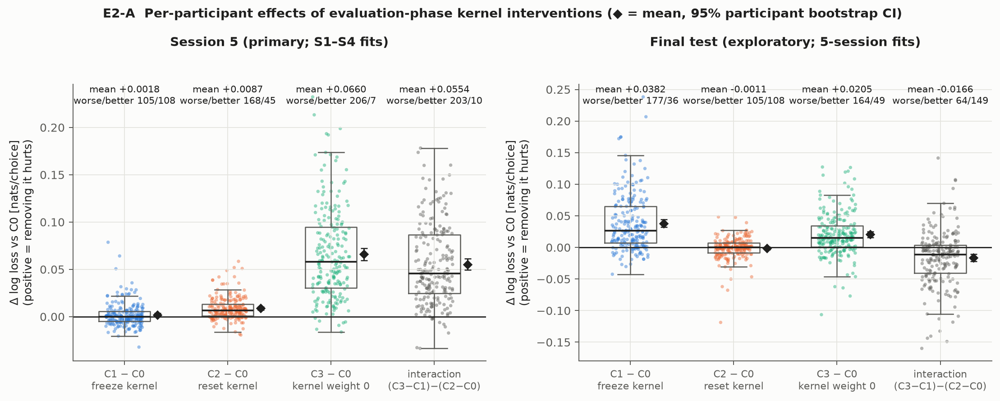
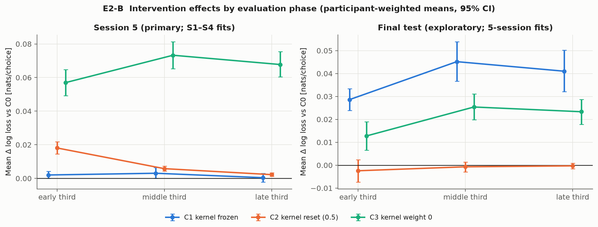
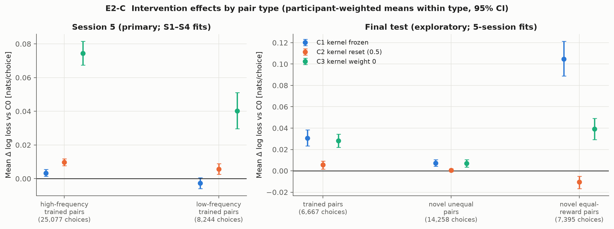
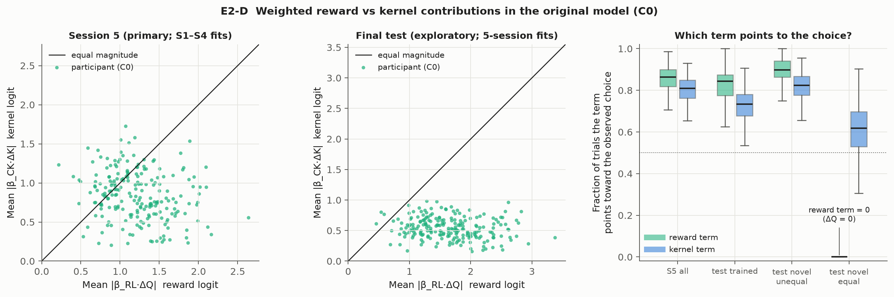
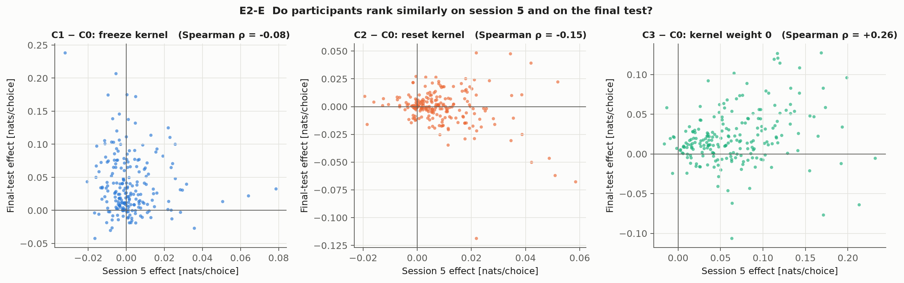

# Experiment 2 — Where does RL+CK’s predictive power come from?

Evaluation-phase ablations of the **unchanged authors’ RL + choice-kernel model** (authors model 19, `released_code_intended`, pi = 0). Fixed saved parameters only: **no parameter is refitted**, no participant is excluded, and `src/reward_pairs/authors_*.py` is untouched. Generated by `scripts/run_ck_ablation.py`; text after the marker near the end is hand-written interpretation and is preserved on regeneration.

## Questions

1. How much predictive performance comes from the kernel state carried into evaluation?
2. How much comes from updating the kernel during evaluation?
3. How much predictive information does the kernel add beyond the reward term?
4. Are these contributions consistent across participants?
5. What should we modify in the authors’ model next?

## Design

**Model.** `P(left) = σ(β_CK(K_L − K_R) + β_RL(Q_L − Q_R))`; both displayed Qs update from feedback with α_RL; K of each displayed stimulus moves toward 1 (chosen) or 0 (rejected) with α_CK. Released-code initialization sets K0 = Q0 = `pre_val`.

**Conditions (applied from the first evaluation trial; everything else identical):**

| Condition | Kernel state at evaluation start | Kernel updates in evaluation | Kernel term in logit | Q |
| --- | --- | --- | --- | --- |
| C0 original | carried in from fitted phase | yes (α_CK) | β_CK·ΔK | unchanged |
| C1 frozen | carried in | **no** | β_CK·ΔK (constant per pair) | unchanged |
| C2 reset | **0.5 for every stimulus** | yes (α_CK) | β_CK·ΔK | unchanged |
| C3 weight 0 | irrelevant | irrelevant | **0** | unchanged |

**Why 0.5 for C2.** K tracks a 0/1 chosen indicator, so its fixed points lie in [0, 1]; 0.5 is the midpoint, i.e. "chosen half the time on appearance", the natural no-preference value in a two-alternative task. Because only K differences enter the logit, any common reset value gives identical first-trial predictions (ΔK = 0); the value only matters through how fast stimuli shown different numbers of times move away from it. Sensitivity resets of 0.0, 1.0 are reported. This is a **diagnostic intervention on fixed parameters, not a newly fitted model**, and the reset value was not tuned.

**2 × 2 structure.** Reset + frozen leaves ΔK = 0 on every trial, which is exactly C3 (unit-tested). So C0–C3 form a factorial: carried-in state {kept, removed} × updating {on, off}. The kernel’s total value C3 − C0 decomposes in two orders, plus an interaction; shares are ratios of participant means, bootstrapped jointly.

**Evaluation sets.**

- **Primary — session 5 (S5).** Saved RL+CK fits to sessions 1–4 (`docs/history_diagnostics_results.json`, 200 starts each), replayed through S1–S4 and scored on S5. S5 keeps reward feedback, so Q updates normally in every condition. S5 contains only the eight trained pairs; they are split into high- and low-frequency training pairs (verified from cohort counts).
- **Secondary — final test (exploratory).** Saved five-session fits (`docs/authors_baseline_results.json`), scored on the final test (no feedback, Q frozen). This test has already been inspected repeatedly; results here are descriptive and are **not** used to select any modification. Pairs are split into trained, novel unequal-reward, and novel equal-reward (2–3, 4–5, 6–7).

**Effects and statistics.** `Δ = loss(condition) − loss(C0)` in nats/choice; positive means removing the ingredient hurts prediction. Participant-weighted means with 95% percentile bootstrap CIs (10,000 participant resamples, seed 20261015, whole participants resampled); trial-weighted values reported separately. Phases are thirds of each participant’s evaluation trials. Ties: |Δ| ≤ 1e-8.

**Contributions.** Per trial, the weighted terms actually used: reward logit `β_RL·ΔQ`, kernel logit `β_CK·ΔK` (left minus right). Summaries: median magnitudes; fraction of trials where |kernel| > |reward|; fraction where the kernel reverses the reward-only direction; fraction where each term points toward the observed choice. Values are per-participant first, then summarized across participants.

## Verification (before any interpretation)

| Check | Worst absolute discrepancy | Tolerance |
| --- | --- | --- |
| fit deviance | 5.68e-13 | 1e-07 |
| carried q | 0.00e+00 | 1e-12 |
| carried k | 0.00e+00 | 1e-12 |
| c0 validation nll | 0.00e+00 | 1e-09 |
| rl validation nll | 0.00e+00 | 1e-09 |
| c0 test deviance | 0.00e+00 | 1e-07 |

C0 reproduces the saved S5 validation NLL and the saved final-test deviance for all 213 participants; the S1–S4 replay reproduces each saved optimizer objective and the saved carried-in Q and K exactly. Q trajectories were asserted identical across all conditions. Separately fitted RL-only references also reproduce their saved S5 losses.

Cohort S1–S4 training-pair counts: {'1-2': 8035, '1-3': 24481, '2-4': 24412, '3-5': 7839, '4-6': 8004, '5-7': 24541, '6-8': 25108, '7-8': 8346}.

**Context: rewards are deterministic per stimulus.** Every training presentation of stimulus 1…8 pays 1, 2, 2, 3, 3, 4, 4, 5 respectively, so after learning, ΔQ = ±1 on every trained pair and 0 on equal pairs. In S5 and the test the reward term is therefore close to a constant ±β_RL per trained pair; within-pair trial-to-trial variation in predictions comes almost entirely from the kernel.

## Results

### Losses by condition

| Set | Participants / choices | C0 | C1 frozen | C2 reset | C3 weight 0 | Separately fitted RL-only |
| --- | --- | --- | --- | --- | --- | --- |
| S5 (primary) | 213 / 33,321 | 0.36607 | 0.36792 | 0.37482 | 0.43206 | 0.40804 |
| Final test (exploratory) | 213 / 28,320 | 0.42216 | 0.46040 | 0.42102 | 0.44264 | 0.45112 |

Participant-weighted mean log loss (nats/choice). Trial-weighted: S5 C0 0.36577, C1 0.36760, C2 0.37452, C3 0.43172; test C0 0.42210, C1 0.46021, C2 0.42102, C3 0.44269.

### Session 5 (primary) — factorial decomposition

| Contrast (Δ loss, nats/choice) | Mean | 95% CI | Median | P5 / P95 | Removal worse / better / tied | Share of total |
| --- | --- | --- | --- | --- | --- | --- |
| Total kernel value: C3 − C0 | +0.06598 | [+0.05964, +0.07240] | +0.05784 | +0.006 / +0.157 | 206 / 7 / 0 |  |
| Updating, given carried-in state: C1 − C0 | +0.00185 | [+0.00021, +0.00365] | -0.00028 | -0.013 / +0.024 | 105 / 108 / 0 | 2.8% [0.3, 5.6] |
| Carried-in state, given updating: C2 − C0 | +0.00875 | [+0.00717, +0.01036] | +0.00646 | -0.005 / +0.035 | 168 / 45 / 0 | 13.3% [11.2, 15.3] |
| Carried-in state, no updating: C3 − C1 | +0.06414 | [+0.05760, +0.07085] | +0.05581 | -0.003 / +0.152 | 199 / 14 / 0 |  |
| Updating, no carried-in state: C3 − C2 | +0.05724 | [+0.05158, +0.06294] | +0.04806 | +0.005 / +0.134 | 208 / 5 / 0 |  |
| Interaction: (C3 − C1) − (C2 − C0) | +0.05539 | [+0.04961, +0.06131] | +0.04560 | +0.001 / +0.131 | 203 / 10 / 0 |  |
| Main effect, carried-in state | +0.03644 | [+0.03267, +0.04028] | +0.03062 | -0.004 / +0.090 | 198 / 15 / 0 |  |
| Main effect, updating | +0.02954 | [+0.02655, +0.03259] | +0.02724 | +0.002 / +0.071 | 209 / 4 / 0 |  |

### Final test (exploratory) — factorial decomposition

| Contrast (Δ loss, nats/choice) | Mean | 95% CI | Median | P5 / P95 | Removal worse / better / tied | Share of total |
| --- | --- | --- | --- | --- | --- | --- |
| Total kernel value: C3 − C0 | +0.02048 | [+0.01592, +0.02497] | +0.01532 | -0.021 / +0.083 | 164 / 49 / 0 |  |
| Updating, given carried-in state: C1 − C0 | +0.03823 | [+0.03233, +0.04433] | +0.02619 | -0.013 / +0.116 | 177 / 36 / 0 | 186.7% [144.9, 245.8] |
| Carried-in state, given updating: C2 − C0 | -0.00114 | [-0.00344, +0.00108] | -0.00019 | -0.023 / +0.022 | 105 / 108 / 0 | -5.6% [-20.5, 4.5] |
| Carried-in state, no updating: C3 − C1 | -0.01776 | [-0.02503, -0.01047] | -0.01333 | -0.111 / +0.067 | 75 / 138 / 0 |  |
| Updating, no carried-in state: C3 − C2 | +0.02162 | [+0.01837, +0.02491] | +0.01658 | -0.009 / +0.073 | 178 / 35 / 0 |  |
| Interaction: (C3 − C1) − (C2 − C0) | -0.01661 | [-0.02237, -0.01080] | -0.01129 | -0.086 / +0.047 | 64 / 149 / 0 |  |
| Main effect, carried-in state | -0.00945 | [-0.01400, -0.00488] | -0.00601 | -0.068 / +0.041 | 79 / 134 / 0 |  |
| Main effect, updating | +0.02993 | [+0.02606, +0.03386] | +0.02308 | -0.004 / +0.086 | 193 / 20 / 0 |  |

**Reset-value sensitivity (C2 with other common values).** S5 reset 0: +0.00894 [+0.00737, +0.01052]; S5 reset 1: +0.00880 [+0.00720, +0.01044]; test reset 0: -0.00039 [-0.00275, +0.00190]; test reset 1: -0.00115 [-0.00348, +0.00104] (compare reset 0.5: S5 +0.00875, test -0.00114).

### By evaluation phase

| Set | Phase | C1 − C0 (worse/better) | C2 − C0 (worse/better) | C3 − C0 (worse/better) |
| --- | --- | --- | --- | --- |
| S5 | early | +0.0020 [+0.000, +0.004] (112/101) | +0.0181 [+0.014, +0.022] (163/50) | +0.0570 [+0.049, +0.065] (189/24) |
| S5 | middle | +0.0031 [+0.000, +0.006] (106/107) | +0.0058 [+0.004, +0.007] (160/46) | +0.0733 [+0.065, +0.081] (197/16) |
| S5 | late | +0.0004 [-0.002, +0.003] (91/122) | +0.0022 [+0.001, +0.003] (146/52) | +0.0677 [+0.060, +0.075] (202/11) |
| test | early | +0.0286 [+0.024, +0.033] (177/36) | -0.0024 [-0.007, +0.002] (102/111) | +0.0128 [+0.007, +0.019] (136/77) |
| test | middle | +0.0452 [+0.037, +0.054] (170/43) | -0.0007 [-0.003, +0.001] (107/102) | +0.0254 [+0.020, +0.031] (162/51) |
| test | late | +0.0410 [+0.032, +0.050] (152/61) | -0.0003 [-0.002, +0.001] (118/84) | +0.0233 [+0.018, +0.029] (157/56) |

### By pair type

| Set | Pair type | Choices | C1 − C0 | C2 − C0 | C3 − C0 | Trial-weighted C1 / C2 / C3 |
| --- | --- | --- | --- | --- | --- | --- |
| S5 | high freq pair | 25,077 | +0.0033 [+0.001, +0.006] (112/101) | +0.0097 [+0.008, +0.012] (167/46) | +0.0744 [+0.067, +0.081] (205/8) | +0.0033 / +0.0097 / +0.0743 |
| S5 | low freq pair | 8,244 | -0.0026 [-0.006, +0.001] (88/125) | +0.0057 [+0.003, +0.009] (134/78) | +0.0403 [+0.030, +0.051] (143/70) | -0.0027 / +0.0058 / +0.0404 |
| test | novel equal | 7,395 | +0.1047 [+0.089, +0.121] (183/30) | -0.0106 [-0.017, -0.005] (83/129) | +0.0392 [+0.029, +0.049] (158/55) | +0.1045 / -0.0102 / +0.0399 |
| test | novel unequal | 14,258 | +0.0074 [+0.004, +0.010] (132/81) | +0.0005 [-0.001, +0.002] (127/86) | +0.0070 [+0.004, +0.010] (139/74) | +0.0074 / +0.0005 / +0.0070 |
| test | trained pair | 6,667 | +0.0305 [+0.023, +0.038] (153/60) | +0.0055 [+0.002, +0.009] (131/82) | +0.0281 [+0.022, +0.034] (157/56) | +0.0303 / +0.0056 / +0.0283 |

### Weighted reward and kernel contributions (C0)

| Set | Subset | Median |reward logit| | Median |kernel logit| | Kernel larger | Kernel reverses reward direction | Reward → choice | Kernel → choice |
| --- | --- | --- | --- | --- | --- | --- | --- |
| S5 | all trials | 1.212 (0.93–1.47) | 0.873 (0.64–1.14) | 0.220 (0.00–0.57) | 0.019 (0.00–0.09) | 0.863 (0.82–0.90) | 0.810 (0.76–0.85) |
| S5 | early | 1.212 (0.93–1.47) | 0.857 (0.61–1.16) | 0.191 (0.00–0.53) | 0.019 (0.00–0.08) | 0.846 (0.79–0.89) | 0.792 (0.73–0.85) |
| S5 | middle | 1.212 (0.93–1.47) | 0.843 (0.66–1.12) | 0.208 (0.00–0.58) | 0.019 (0.00–0.09) | 0.868 (0.83–0.92) | 0.824 (0.77–0.87) |
| S5 | late | 1.212 (0.93–1.47) | 0.856 (0.65–1.14) | 0.208 (0.00–0.59) | 0.019 (0.00–0.09) | 0.865 (0.83–0.91) | 0.811 (0.75–0.86) |
| S5 | high_freq_pair | 1.212 (0.93–1.47) | 0.950 (0.70–1.20) | 0.250 (0.00–0.62) | 0.000 (0.00–0.00) | 0.907 (0.87–0.94) | 0.891 (0.83–0.93) |
| S5 | low_freq_pair | 1.212 (0.93–1.47) | 0.556 (0.40–0.71) | 0.077 (0.00–0.39) | 0.075 (0.00–0.34) | 0.737 (0.65–0.82) | 0.575 (0.47–0.65) |
| test | all trials | 1.250 (0.96–1.52) | 0.475 (0.37–0.61) | 0.267 (0.26–0.30) | 0.000 (0.00–0.01) | 0.659 (0.62–0.70) | 0.748 (0.71–0.79) |
| test | early | 1.250 (0.96–1.52) | 0.498 (0.40–0.69) | 0.289 (0.24–0.33) | 0.000 (0.00–0.02) | 0.667 (0.62–0.73) | 0.711 (0.67–0.76) |
| test | middle | 1.278 (0.97–1.59) | 0.459 (0.35–0.60) | 0.289 (0.24–0.31) | 0.000 (0.00–0.00) | 0.667 (0.60–0.71) | 0.756 (0.71–0.82) |
| test | late | 1.250 (0.96–1.53) | 0.457 (0.35–0.59) | 0.273 (0.24–0.30) | 0.000 (0.00–0.00) | 0.659 (0.60–0.71) | 0.773 (0.71–0.82) |
| test | novel_equal | 0.000 (0.00–0.00) | 0.382 (0.29–0.56) | 1.000 (1.00–1.00) | 0.000 (0.00–0.00) | 0.000 (0.00–0.00) | 0.618 (0.53–0.70) |
| test | novel_unequal | 2.500 (1.92–3.05) | 0.558 (0.43–0.69) | 0.000 (0.00–0.00) | 0.000 (0.00–0.00) | 0.897 (0.86–0.94) | 0.824 (0.78–0.87) |
| test | trained_pair | 1.250 (0.96–1.52) | 0.419 (0.31–0.54) | 0.000 (0.00–0.12) | 0.000 (0.00–0.00) | 0.844 (0.77–0.88) | 0.733 (0.68–0.78) |

Cells: median across participants (IQR) of each participant’s per-trial summary. On novel equal pairs ΔQ = 0, so the reward term is 0 and the kernel alone sets the prediction; “reverses direction” is undefined there and counted as 0.

### Consistency across participants and evaluation sets

Spearman correlation of participant effects, S5 vs final test: total kernel value ρ = +0.26 (p = 9.6e-05); updating given carried state ρ = -0.08 (p = 0.27); carried state given updating ρ = -0.15 (p = 0.025).

### Parameter context (descriptive only)

| Fit | α_CK median (IQR) | Kernel half-life, appearances: median (IQR) | β_CK median | α_RL = 1 (upper bound) | β_RL median |
| --- | --- | --- | --- | --- | --- |
| S1–S4 (primary) | 0.129 (0.082–0.204) | 5.0 (3.0–8.1) | 1.59 | 82 / 213 | 1.21 |
| S1–S5 (test) | 0.121 (0.074–0.199) | 5.4 (3.1–9.0) | 1.62 | 83 / 213 | 1.25 |

## Limitations

- Interventions are counterfactual scorings of parameters fitted under the original model; a model *fitted* without updating or with a different reset could re-weight β_RL/β_CK and perform differently.
- C3 removes the kernel but keeps the RL+CK-fitted β_RL, which was estimated jointly with the kernel; the separately fitted RL-only column is the appropriate “no kernel” model comparison.
- S5 contains only trained pairs with feedback; the novel-pair and no-feedback questions can only be examined on the already-inspected final test, so those results are exploratory.
- Bootstrap CIs are not multiplicity-adjusted across the many contrasts shown.
- Nothing here identifies a psychological habit mechanism; the kernel is a predictive state variable.

<!-- Reviewed interpretation -->

## Answers

The session-5 (S5) results are the primary, held-out evidence. Final-test results are exploratory. All
values are participant-weighted Δ log loss in nats/choice, with 95% participant-bootstrap CIs.

**1. How much comes from the carried-in kernel state?** In S5, most of it — as long as the kernel
cannot rebuild that state. With updating left on, resetting the kernel costs +0.0088 [0.0072,
0.0104], which is 13% of the kernel's total value. The cost is concentrated in the first third
(+0.018) and shrinks to +0.002 by the last third. With updating off, the carried-in state supplies
+0.064 of the +0.066 total. At the final test, the carried-in state contributes nothing once updating
is on (−0.0011 [−0.0034, +0.0011]). Frozen on its own, it is *worse* than no kernel at all
(C3 − C1 = −0.018; removing it helps 138/213 people).

**2. How much comes from updating during evaluation?** In S5, almost nothing on top of the
carried-in state: freezing costs +0.0019 [0.0002, 0.0037], 2.8% of the total, with median −0.0003.
People split 105/108 on whether it helps. On low-frequency pairs, freezing slightly *improves*
prediction. At the final test, updating is the whole story: freezing costs +0.038 [0.032, 0.044],
which is more than the kernel's entire net value. 177/213 people are hurt by freezing. On the novel
equal-reward pairs the cost is +0.105 per choice.

**Why the two sets differ — the interaction.** In S5 the interaction is large and positive
(+0.055). The two sources are **substitutes**: either the carried-in state or rapid relearning
(median half-life about 5 appearances) recovers almost all the kernel's value. That is what a
stable, per-stimulus choice tendency would produce in data that behave the same as in sessions 1–4.
At the final test the interaction is negative (−0.017). There is no feedback and there are novel
pairs, so choices depart from the training-derived tendencies. The kernel helps only by **tracking
test-phase choices**. A kernel frozen at its training state misleads.

**3. Information beyond the reward term.** Substantial in S5. Zeroing the kernel costs +0.066
[0.060, 0.072], and 206/213 people are worse off. Against a separately fitted RL-only model, which
is the fair no-kernel comparison, RL+CK is better by 0.042 (0.366 vs 0.408). The kernel term is about
70% the size of the reward term (median |logit| 0.87 vs 1.21). It points the same way as the reward
term on most trials. For the median participant it reverses the reward-only direction on only 1.9%
of S5 trials, or 7.5% on low-frequency pairs. Because training rewards are deterministic, ΔQ is a constant ±1 on every
trained pair after learning. In S5, then, the kernel mainly adjusts **how confident** the prediction
is for each stimulus and pair; it rarely changes the predicted direction. At the final test, the net
gain is smaller (+0.020; RL+CK 0.422 vs RL 0.451) and concentrated on novel equal pairs (+0.039),
where the reward term is exactly zero and the kernel alone sets the prediction.

**4. Consistency across participants.** The kernel's overall benefit is very consistent within S5
(206/213) and largely consistent at test (164/213). The updating effect is consistent at test
(177/213) but essentially zero-centered within S5. Participant *rankings* barely carry over between
the two sets: Spearman ρ = +0.26 for total kernel value, −0.08 for updating, and −0.15 for reset.
That fits context-dependent effects better than stable individual traits, though per-person
estimates rest on about 130–160 choices each.

**5. What to modify next.** The evidence points at the kernel's **timescale and its interaction with
context**. Reward learning matters less, since Q reaches the deterministic true values by late
training. A single α_CK has to serve two roles. In stationary training it acts as a near-stable
per-stimulus confidence term, where updating adds little. At the test it acts as a fast tracker of
changed behavior, where updating is essential. Initialization is a lower priority for prediction:
reset values of 0, 0.5, and 1 give nearly identical results, because the state is overwritten
within a few appearances. Initialization may still matter for **estimating** α_CK. The paper-style
zero initialization yields median α_CK 0.05, against 0.12 under the released `pre_val`
initialization, which lies on a 0–4.1 scale.

### Strongest supported interpretation

In the authors' RL+CK model, the choice kernel carries real held-out information beyond learned
reward value, and this holds for nearly every participant. How it carries that information depends
on context. Within stationary, feedback-rich training, it is a redundant, quickly relearned
per-stimulus choice tendency, mostly aligned with value. At the no-feedback test with novel pairs,
its benefit comes entirely from updating on the participant's own test choices, and the state carried
over from training is useless or harmful. This is a statement about a predictive state variable, not
evidence for a psychological habit mechanism.

### Next testable hypotheses (not implemented)

1. **H1 — α_CK is weakly identified by training data alone.** Freezing barely matters in S5, so
   training choices contain little signal about adaptation speed. Prediction: a profile likelihood
   over α_CK (β_CK, α_RL, and β_RL re-optimized at each grid value) is flat across a range that
   includes both the 0.05 and 0.12 estimates. S5 held-out loss varies by less than its participant
   bootstrap CI across that range. This is the planned α sensitivity/profile study.
2. **H2 — The released off-scale kernel initialization inflates α_CK.** Prediction: refitting with
   K0 rescaled to [0, 1], or set to 0.5, lowers fitted α_CK toward the paper-style value. S5 held-out
   loss changes by less than 0.005 nats/choice. Compare as a separate variant against the unchanged
   baseline on S1–S4 → S5.
3. **H3 — One timescale cannot serve both roles.** Prediction: a kernel with a slow and a fast
   component, or a learning rate that differs by phase, matches the baseline on S5 but tracks
   behavior changes faster. Because H1 implies training data may not identify the fast component,
   this needs a predeclared evaluation that does not tune on the final test. Candidates are
   S1–S3 → S4 and S5 folds, plus synthetic parameter recovery.
