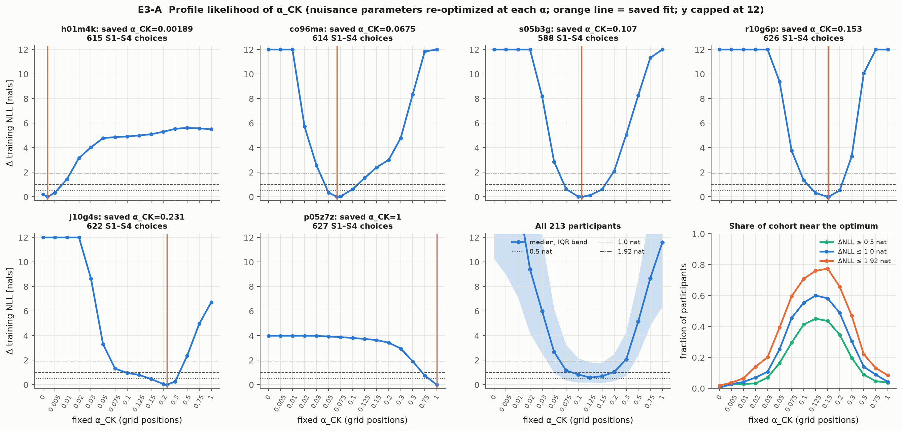
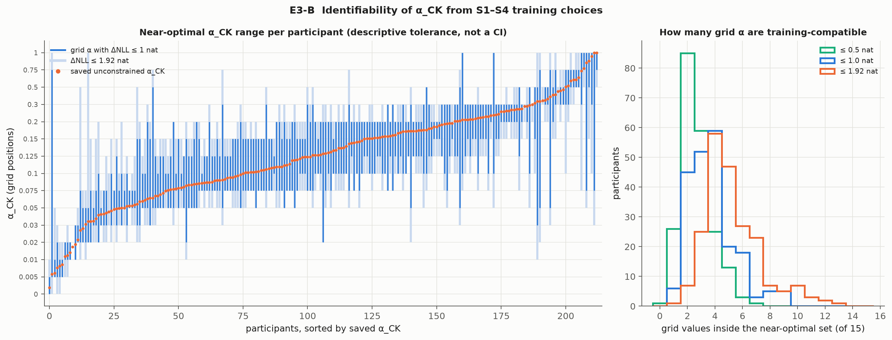
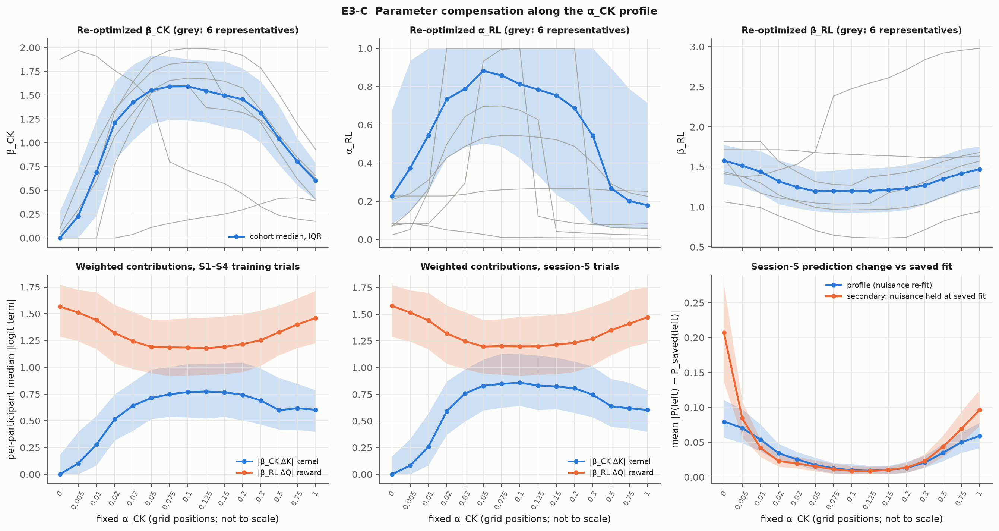
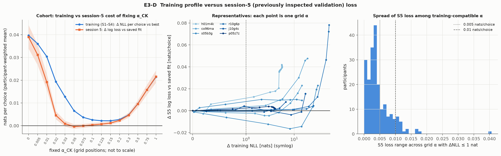
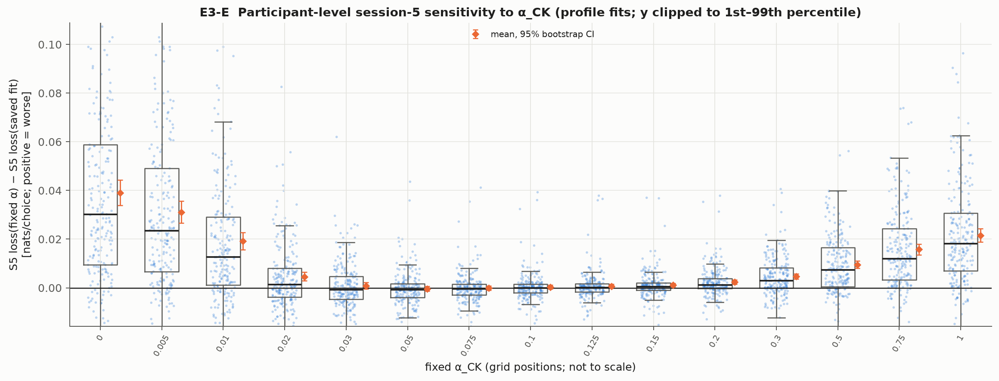

# Experiment 3: identifiability and sensitivity of the choice-kernel learning rate α_CK

Authors' RL+CK (model 19, `released_code_intended`, π = 0, bias fixed at 2.5). Fit on training sessions 1–4, scored on training session 5. Session 5 was already inspected in earlier experiments, so it is **previously inspected held-out validation, not an untouched prospective test**. The final test is never read.

## 1. Question and method

Choice rule: P(left) = σ(β_RL (Q_L − Q_R) + β_CK (K_L − K_R)), with K_i ← K_i + α_CK (I_i − K_i) for the two displayed stimuli and Q_i ← Q_i + α_RL (r_i − Q_i) from feedback.

*Profile likelihood.* For each fixed α_CK on a predetermined grid, β_CK, α_RL and β_RL are re-optimized to minimize the unchanged authors' training deviance; ΔNLL(α) = [D(α) − D_min]/2 nats, where D_min is the smaller of the saved unconstrained optimum and every constrained optimum. Each participant's saved α_CK is added as an anchor point.

Grid: 0, 0.005, 0.01, 0.02, 0.03, 0.05, 0.075, 0.1, 0.125, 0.15, 0.2, 0.3, 0.5, 0.75, 1. The grid is used for every cohort summary, and the anchor is used only for checks.

*Secondary diagnostic (not a profile).* α_CK varied with β_CK, α_RL, β_RL held at their saved values. Comparing it with the profile shows how much the nuisance parameters compensate.

## 2. Data and fitting protocol

- 213 participants; 213 have complete successful profiles at every grid point (excluded: none).
- Training choices per participant (S1–S4): median 618 (range 534–637); session-5 choices: median 158 (range 133–160).
- Initialization: released-code K0 = Q0 = pre_val (up to ≈4.1), unchanged. Note that at α_CK = 0, K never moves from K0 = Q0, so the kernel term becomes a **fixed pre-training preference** β_CK(K0_L − K0_R), not "no kernel". At α_CK = 1, K holds only the last choice outcome for each stimulus.
- Optimizer: SciPy L-BFGS-B with the authors' bounds [[0.0, 10.0], [0.0, 1.0], [0.0, 10.0]] (β_CK, α_RL, β_RL) and the options used by `authors_fitting` ({'ftol': 1e-12, 'gtol': 1e-07, 'maxiter': 1000, 'maxls': 40}).
- Starts at each α: the saved nuisance values, 20 random starts (numpy default_rng([20261107, source_index]); same ranges as the authors' driver), and one warm start from each neighbouring grid solution (an ascending sweep, then a descending sweep). The best successful start is kept.
- Session 5: `history_diagnostics.replay_fold`. Q and K are carried from the end of S4, both keep updating, parameters stay fixed, and each prediction precedes its own update.
- Bootstrap: participant resampling, 10000 draws, seed 20261015.
- Software: Python 3.12.4, NumPy 2.5.3, SciPy 1.18.1. Compute: 213 participants in 111 s with 4 workers (this rendering: 4 s).

## 3. Reproduction and optimization checks

| check | worst over participants | tolerance |
| --- | --- | --- |
| saved S1–S4 fit deviance vs replay | 5.7e-13 | 1e-07 |
| fast objective vs scalar replay | 5.7e-13 | 1e-07 |
| saved session-5 NLL vs replay | 0.0e+00 | 1e-09 |
| constrained fit at saved α minus saved deviance (max) | 1.1e-13 | ≤ 1e-06 |

- 3406 profile points (77912 optimizer starts): **0 failed points**, 74 individual failed starts (all superseded by successful starts at the same α and recorded in the cache).
- Constrained optima better than the saved unconstrained optimum by more than 1e-06 deviance: **0**.
- Winning start type: {'random': 2030, 'saved_baseline': 1206, 'warm_down': 87, 'warm_up': 83}. Median share of random starts that reach the best value: 0.80 (5th percentile 0.15); points where no random start reached the best value: 10.
- Largest projected gradient at an accepted optimum: 4.3e-04 (deviance units).
- Pilot (9 participants spanning the saved α distribution, `experiment3_alpha_pilot.json`): 100 random starts changed no point by more than 1e-6 deviance compared with 20 starts.

## 4. Identifiability

Saved unconstrained α_CK: median 0.129, IQR 0.082–0.204.

The near-optimal set is the set of grid α with ΔNLL ≤ tolerance. The tolerances are descriptive. 1.92 nats is the value a naive χ²₁ 95% rule would give, but it is not used as a confidence interval: α_CK and α_RL lie on or near their bounds for many participants, the profile is often multimodal or flat, and the nuisance parameters trade off strongly, all of which break the asymptotic χ² approximation.

| tolerance (nats) | median grid points inside | flat (all 15) | includes α=0 | includes α=1 | non-contiguous | upper/lower ≥ 3× | upper/lower ≥ 10× |
| --- | --- | --- | --- | --- | --- | --- | --- |
| 0.5 | 2 | 0 | 1 | 8 | 3 | 12 | 3 |
| 1.0 | 4 | 0 | 1 | 9 | 1 | 46 | 12 |
| 1.92 | 5 | 0 | 4 | 18 | 1 | 100 | 30 |

Each count is out of 213 participants. Upper/lower ratios with lower = 0 count as ≥ 10×.

With the 1-nat tolerance, the lower end of the near-optimal set has median 0.075 (IQR 0.05–0.125) and the upper end has median 0.2 (IQR 0.125–0.3). The upper/lower α ratio has median 2.00. In half-lives (presentations of a stimulus), the set spans a median 3.1 to 8.9, a median ratio of 2.12× (95th percentile 6.6×).
Multimodality: 22 participants have more than one local minimum on the grid; the second minimum lies within 1 nat of the best for 9 and within 2 nats for 12.

### Cohort profile by grid α

| α_CK | half-life (presentations) | median ΔNLL | IQR ΔNLL | within 1 nat | mean Δ train loss/choice | mean Δ S5 loss [95% CI] | S5 worse / better |
| --- | --- | --- | --- | --- | --- | --- | --- |
| 0 | never updates | 20.86 | 10.28–34.94 | 1 | 0.0397 | +0.0390 [+0.0339, +0.0443] | 187 / 26 |
| 0.005 | 1.4e+02 | 18.23 | 8.96–32.47 | 6 | 0.0360 | +0.0311 [+0.0267, +0.0357] | 184 / 29 |
| 0.01 | 69 | 15.31 | 7.11–28.56 | 9 | 0.0304 | +0.0192 [+0.0157, +0.0228] | 166 / 47 |
| 0.02 | 34 | 9.40 | 4.18–18.25 | 15 | 0.0194 | +0.0046 [+0.0029, +0.0064] | 122 / 91 |
| 0.03 | 23 | 6.01 | 2.54–11.89 | 23 | 0.0127 | +0.0009 [-0.0004, +0.0022] | 94 / 119 |
| 0.05 | 14 | 2.68 | 0.98–6.15 | 54 | 0.0066 | -0.0004 [-0.0013, +0.0006] | 88 / 125 |
| 0.075 | 8.9 | 1.16 | 0.34–3.26 | 97 | 0.0037 | -0.0001 [-0.0009, +0.0008] | 92 / 121 |
| 0.1 | 6.6 | 0.84 | 0.19–2.17 | 118 | 0.0026 | +0.0003 [-0.0005, +0.0012] | 105 / 108 |
| 0.125 | 5.2 | 0.58 | 0.20–1.82 | 128 | 0.0022 | +0.0007 [-0.0001, +0.0015] | 115 / 98 |
| 0.15 | 4.3 | 0.70 | 0.15–1.80 | 124 | 0.0022 | +0.0011 [+0.0004, +0.0019] | 122 / 91 |
| 0.2 | 3.1 | 1.04 | 0.30–2.50 | 104 | 0.0027 | +0.0023 [+0.0015, +0.0032] | 146 / 67 |
| 0.3 | 1.9 | 2.07 | 0.74–4.32 | 65 | 0.0048 | +0.0046 [+0.0036, +0.0057] | 154 / 59 |
| 0.5 | 1 | 5.16 | 2.40–8.61 | 30 | 0.0096 | +0.0095 [+0.0080, +0.0111] | 168 / 45 |
| 0.75 | 0.5 | 8.67 | 4.83–14.27 | 19 | 0.0157 | +0.0158 [+0.0136, +0.0180] | 188 / 25 |
| 1 | old state erased at 1st update | 11.59 | 6.38–19.25 | 9 | 0.0214 | +0.0216 [+0.0189, +0.0243] | 192 / 19 |

## 5. Parameter compensation

Within-participant Spearman correlation between the fixed α_CK and each re-optimized quantity across the 15 grid points (counts with ρ > 0.5 or < −0.5):

| quantity | median ρ | ρ > 0.5 | ρ < −0.5 |
| --- | --- | --- | --- |
| beta_ck | +0.16 | 24 | 15 |
| alpha_rl | -0.13 | 12 | 48 |
| beta_rl | -0.28 | 20 | 40 |
| train_components.median_abs_kernel | +0.46 | 95 | 12 |
| train_components.median_abs_reward | -0.28 | 14 | 40 |
| s5_components.median_abs_kernel | +0.36 | 64 | 10 |
| s5_components.median_abs_reward | -0.28 | 19 | 40 |

| α_CK | median β_CK | median α_RL | median β_RL | α_RL at a bound | median |kernel logit| train | median |reward logit| train | S5 mean |ΔP| profile | S5 mean |ΔP| fixed nuisance | ΔNLL fixed nuisance (median) |
| --- | --- | --- | --- | --- | --- | --- | --- | --- | --- |
| 0 | 0.00 | 0.23 | 1.58 | 39 | 0.00 | 1.57 | 0.080 | 0.207 | 109.7 |
| 0.005 | 0.23 | 0.37 | 1.51 | 48 | 0.10 | 1.51 | 0.070 | 0.084 | 52.5 |
| 0.01 | 0.69 | 0.55 | 1.44 | 61 | 0.28 | 1.44 | 0.054 | 0.042 | 30.4 |
| 0.02 | 1.21 | 0.73 | 1.32 | 76 | 0.52 | 1.32 | 0.034 | 0.023 | 12.8 |
| 0.03 | 1.43 | 0.79 | 1.25 | 84 | 0.64 | 1.24 | 0.025 | 0.020 | 7.3 |
| 0.05 | 1.55 | 0.88 | 1.20 | 91 | 0.71 | 1.19 | 0.018 | 0.015 | 3.0 |
| 0.075 | 1.59 | 0.86 | 1.20 | 90 | 0.75 | 1.19 | 0.013 | 0.011 | 1.4 |
| 0.1 | 1.59 | 0.81 | 1.20 | 89 | 0.77 | 1.18 | 0.010 | 0.009 | 1.0 |
| 0.125 | 1.55 | 0.78 | 1.20 | 85 | 0.77 | 1.18 | 0.009 | 0.009 | 0.7 |
| 0.15 | 1.50 | 0.75 | 1.21 | 83 | 0.77 | 1.19 | 0.010 | 0.010 | 0.9 |
| 0.2 | 1.46 | 0.69 | 1.23 | 75 | 0.74 | 1.22 | 0.013 | 0.014 | 1.3 |
| 0.3 | 1.31 | 0.54 | 1.27 | 65 | 0.69 | 1.25 | 0.021 | 0.023 | 3.0 |
| 0.5 | 1.04 | 0.27 | 1.35 | 51 | 0.60 | 1.33 | 0.035 | 0.044 | 9.4 |
| 0.75 | 0.80 | 0.20 | 1.42 | 47 | 0.62 | 1.40 | 0.050 | 0.069 | 21.8 |
| 1 | 0.60 | 0.18 | 1.47 | 43 | 0.60 | 1.46 | 0.059 | 0.097 | 40.5 |

## 6. Session-5 validation sensitivity

Saved-fit session-5 loss (participant mean): 0.36607 nats/choice. Effects below are S5 loss at the profile fit for a fixed α minus S5 loss at the saved fit, so positive means worse. No α is selected on session 5.

- Within the 1-nat training-compatible set, the S5 loss range has median 0.0036, 75th percentile 0.0059 and 95th percentile 0.0115 nats/choice. The range exceeds 0.005 for 64 participants and 0.01 for 21.
- Worst S5 change (vs the saved fit) among each participant's training-compatible α: mean +0.0027 [+0.0023, +0.0032]; more than 0.005 for 26 participants and more than 0.01 for 5.
- Within-participant Spearman ρ between training ΔNLL and S5 Δ across the grid: median +0.64 (IQR +0.34 to +0.87).
- Trial-weighted cohort S5 Δ by α: 0: +0.0391, 0.005: +0.0312, 0.01: +0.0192, 0.02: +0.0046, 0.03: +0.0009, 0.05: -0.0004, 0.075: -0.0001, 0.1: +0.0003, 0.125: +0.0007, 0.15: +0.0011, 0.2: +0.0023, 0.3: +0.0046, 0.5: +0.0095, 0.75: +0.0158, 1: +0.0216.

Training cost by session: S1–S4 log loss at the profile fit minus log loss at the saved fit, per choice (participant mean [95% CI]), shown next to the session-5 change. This is descriptive, because S1–S4 are the fitted data.

| α_CK | S1 | S2 | S3 | S4 | S5 (held out) |
| --- | --- | --- | --- | --- | --- |
| 0 | +0.0261 [+0.0217, +0.0305] | +0.0466 [+0.0413, +0.0520] | +0.0436 [+0.0390, +0.0484] | +0.0419 [+0.0372, +0.0468] | +0.0390 |
| 0.005 | +0.0272 [+0.0227, +0.0317] | +0.0433 [+0.0383, +0.0484] | +0.0383 [+0.0339, +0.0428] | +0.0352 [+0.0306, +0.0398] | +0.0311 |
| 0.01 | +0.0319 [+0.0271, +0.0367] | +0.0378 [+0.0333, +0.0424] | +0.0288 [+0.0250, +0.0328] | +0.0235 [+0.0197, +0.0275] | +0.0192 |
| 0.02 | +0.0385 [+0.0334, +0.0436] | +0.0222 [+0.0191, +0.0256] | +0.0108 [+0.0087, +0.0130] | +0.0069 [+0.0049, +0.0089] | +0.0046 |
| 0.03 | +0.0352 [+0.0307, +0.0400] | +0.0109 [+0.0090, +0.0130] | +0.0037 [+0.0023, +0.0051] | +0.0020 [+0.0008, +0.0033] | +0.0009 |
| 0.05 | +0.0240 [+0.0207, +0.0275] | +0.0024 [+0.0014, +0.0035] | +0.0004 [-0.0006, +0.0013] | +0.0001 [-0.0007, +0.0011] | -0.0004 |
| 0.075 | +0.0144 [+0.0121, +0.0169] | +0.0005 [-0.0003, +0.0013] | +0.0001 [-0.0006, +0.0008] | +0.0001 [-0.0006, +0.0009] | -0.0001 |
| 0.1 | +0.0087 [+0.0069, +0.0106] | +0.0006 [-0.0001, +0.0013] | +0.0006 [-0.0001, +0.0012] | +0.0006 [-0.0000, +0.0014] | +0.0003 |
| 0.125 | +0.0054 [+0.0038, +0.0070] | +0.0011 [+0.0004, +0.0018] | +0.0011 [+0.0005, +0.0017] | +0.0012 [+0.0006, +0.0019] | +0.0007 |
| 0.15 | +0.0034 [+0.0019, +0.0050] | +0.0018 [+0.0011, +0.0026] | +0.0018 [+0.0012, +0.0024] | +0.0017 [+0.0011, +0.0024] | +0.0011 |
| 0.2 | +0.0011 [-0.0003, +0.0026] | +0.0034 [+0.0025, +0.0043] | +0.0032 [+0.0025, +0.0040] | +0.0031 [+0.0024, +0.0039] | +0.0023 |
| 0.3 | +0.0006 [-0.0009, +0.0022] | +0.0066 [+0.0054, +0.0077] | +0.0061 [+0.0050, +0.0071] | +0.0057 [+0.0048, +0.0067] | +0.0046 |
| 0.5 | +0.0031 [+0.0012, +0.0049] | +0.0125 [+0.0110, +0.0141] | +0.0115 [+0.0099, +0.0130] | +0.0112 [+0.0097, +0.0128] | +0.0095 |
| 0.75 | +0.0075 [+0.0052, +0.0098] | +0.0194 [+0.0173, +0.0216] | +0.0178 [+0.0158, +0.0200] | +0.0179 [+0.0157, +0.0202] | +0.0158 |
| 1 | +0.0120 [+0.0094, +0.0147] | +0.0256 [+0.0228, +0.0284] | +0.0238 [+0.0212, +0.0265] | +0.0241 [+0.0212, +0.0270] | +0.0216 |

<!-- Reviewed interpretation -->

## 7. Interpretation and limitations

### Answers

**Is α_CK well identified for most participants?** It is moderately identified: the location is clear, the precise value is not. No participant has a flat profile; all 213 have a clear interior or boundary minimum, and the cohort median ΔNLL at α = 0 and α = 1 is 20.9 and 11.6 nats. Within the descriptive 1-nat tolerance, though, a typical participant is compatible with a median of 4 grid values, spanning about a factor of 2 in α (median set 0.075–0.2). For 46/213 the span is at least 3×, and for 12 it is at least 10×. 22 participants have a two-minimum profile, and for 9 of them the second minimum is within 1 nat of the best.

**Are there participants with nearly flat profiles?** None is flat over the whole grid. A minority are flat over one side: some have a minimum at α ≈ 0 with only a 4–6 nat rise toward 1 (for example h01m4k), and some are near-flat below a minimum at α = 1 (p05z7z: ΔNLL ≤ 4 everywhere). The 1-nat set includes α = 1 for 9 participants and α = 0 for 1.

**Which parameters compensate?** The compensation is non-monotone, not a simple linear trade-off. Moving α away from about 0.1 in *either* direction lowers the re-optimized β_CK (median 1.59 → 0.60 at α = 1, → 0 at α = 0) and α_RL (0.88 → 0.18–0.23), while β_RL rises (1.20 → 1.47–1.58). In effect the model hands weight from the kernel to the reward term as the kernel's timescale becomes implausible. At α = 0 the kernel is a static copy of the pre-training ratings (K0 = Q0) and is switched off (β_CK → 0). Near the optimum (0.05–0.2), compensation is small: holding the nuisance parameters fixed gives similar training costs (median 1.0 vs 0.84 nats at α = 0.1) and similar S5 prediction changes (|ΔP| about 0.01). Far from the optimum, re-fitting the nuisance parameters recovers most of the loss (α = 1: 40.5 → 11.6 nats; α = 0: 110 → 21 nats). Re-fitting can preserve predictions only approximately. The S5 mean |ΔP| relative to the saved fit stays ≤ 0.013 inside 0.075–0.2 but reaches 0.06–0.08 at the extremes.

**Does session-5 performance depend materially on α?** Only outside the training-compatible band. Fixing α anywhere in 0.03–0.15 changes the mean S5 loss by at most ±0.0011 nats/choice. Every 95% CI from 0.03 to 0.125 includes 0 (0.15 is +0.0011 [+0.0004, +0.0019]). E2 measured the kernel's total S5 value at 0.066, so the uncertainty in α_CK costs well under 2% of that. Extreme values are clearly worse: +0.039 at α = 0 and +0.022 at α = 1. Within each participant's own 1-nat set, the S5 loss range has median 0.0036 nats/choice, and the worst member of the set averages +0.0027. Training and S5 rankings of α agree within participants (median Spearman +0.64). Training-indistinguishable α values therefore do **not** generally produce materially different S5 predictions; 21/213 participants have a within-set S5 range above 0.01. The weak identification is real, but at this scale it is not a generalization problem.

**Do training-compatible α values imply different memory timescales?** Yes, numerically. Inside the 1-nat set, the kernel half-life spans a median 3.1 to 8.9 presentations of a stimulus, a median 2.1× ratio (95th percentile 6.6×). The data therefore support "a few presentations to about ten", not a precise timescale. These are encounter counts under this model, not calibrated psychological memory durations.

**What does this say about the authors' model?** The released initialization and early training are the clearest new finding. The session breakdown in §6 shows that the training cost of low α is concentrated in **session 1**. At α = 0.05, S1 costs +0.024 nats/choice, while S2–S4 cost ≤ 0.0024, S3–S4 have CIs that include 0, and S5 is −0.0004. Conversely, α ≥ 0.2 costs nothing in S1 (+0.0011 at 0.2, CI includes 0) but costs throughout S2–S4 and S5. So S1 favours a fast kernel and S2–S5 favour a slower one (≈ 0.05–0.1), and the single fitted α (median 0.129) is a compromise between them. One plausible reason is that the released kernel starts at K0 = pre_val (up to ≈ 4.1, off the 0–1 scale that choice indicators pull toward), so a small α would take many S1 presentations to wash out that initial state. A genuine early-learning change in choice dynamics would produce the same pattern; E3 cannot tell the two apart, because K0 and Q0 are the same pre-training values.

### Limitations

- Session 5 has been inspected before (E2 and the earlier diagnostics), so it is a previously used validation fold, not a prospective test. No α was chosen on it.
- Near-optimal sets are evaluated on a 15-point grid. The sets are coarse, and widths are quantized to grid spacing. The anchor at each saved α is used only for checks.
- The tolerances (0.5, 1, 1.92 nats) are descriptive. Parameters at bounds (α_RL = 1 in 82/213 saved fits; α_RL is at a bound for 75–91 participants at each grid α between 0.02 and 0.2), multimodal profiles, and strong nuisance trade-offs at the extremes make χ²-calibrated intervals unreliable. A parametric-bootstrap calibration would be needed to turn ΔNLL into coverage statements.
- Optimization: 0 failed points and 0 cases of a constrained fit beating the saved optimum. For 10 of 3,406 points only the saved or warm starts found the best value, so they rest on continuation rather than random-start agreement. The pilot with 100 random starts found no improvement, but non-convexity cannot be fully excluded.
- The per-session costs describe the fitted data (S1–S4), not held-out performance. They identify where the likelihood information on α comes from; they do not test a mechanism.
- Identifiability of a parameter says nothing about whether a habit-like process exists. The kernel remains a predictive state variable.

## 8. Implications and hypotheses for Experiment 4

All of these use the same S1–S4 → S5 protocol, the released Q initialization and update, and an unchanged final test.

1. **H4a — kernel initialization on the choice-indicator scale.** Set K0 to a principled 0–1 value (for example a common 0.5, or the pretest choice proportions themselves, which already lie in [0, 1]). Keep Q0 and everything else unchanged and refit. Prediction: the session-1 penalty on small α shrinks, the fitted α_CK falls toward the S2–S5-preferred 0.05–0.1, the profile's lower edge moves left, and S5 loss changes by less than ±0.003 nats/choice. If S1 still strongly favours α ≥ 0.2 after this change, the early-fast pattern is behavioural, not an initialization artefact.
2. **H4b — the early-session dependence is in the choice data, not only in K0.** Re-profile α_CK on S2–S4 only, with states carried through S1 at the unconstrained fit, as a pre-declared descriptive check. Prediction: the profile narrows around 0.05–0.1. The comparison between H4a and H4b separates initialization from early-learning dynamics.
3. **H4c — conditional on H4a/H4b only.** If the early-fast/late-slow split survives a 0–1 K0, a pre-registered two-rate kernel (one α for S1, one for S2+) is the minimal extension to test against the baseline on S5. A two-timescale kernel should not be fitted before H4a has been run.
