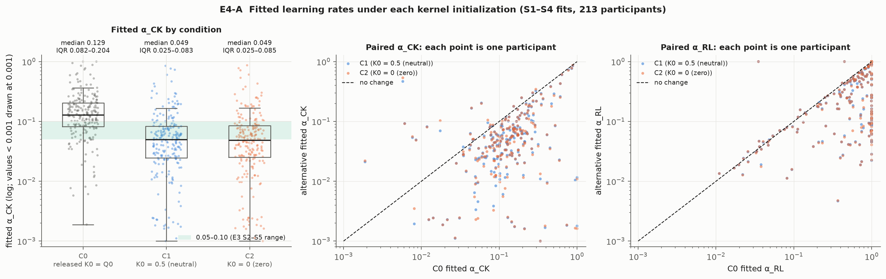
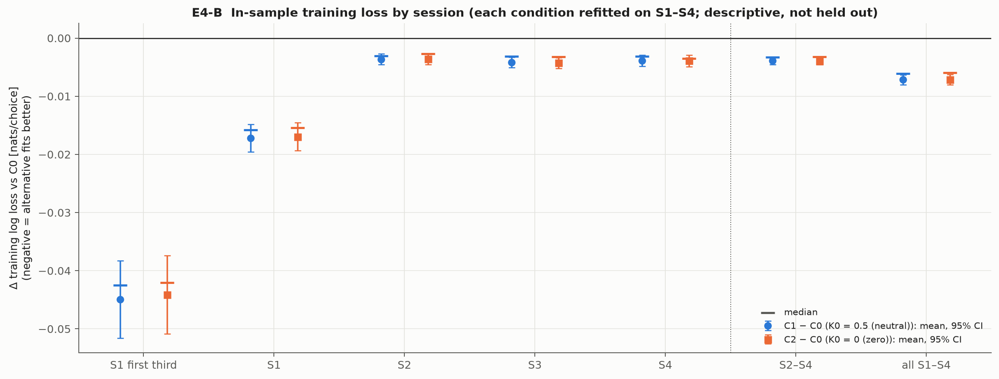
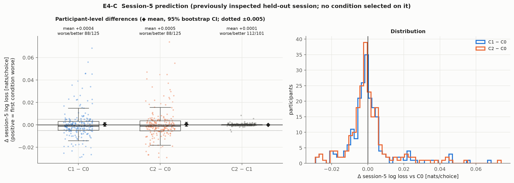
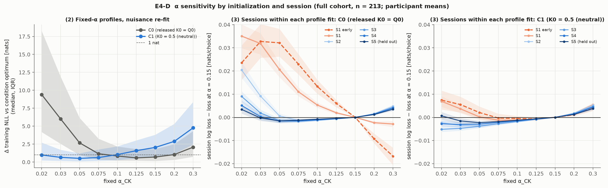
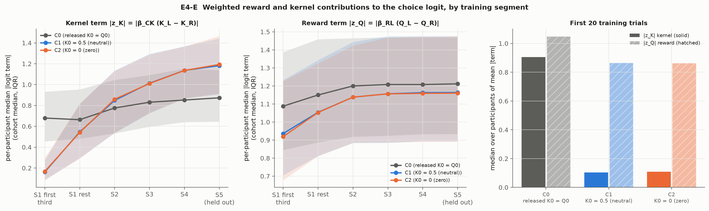

# Experiment 4: choice-kernel initialization and the fitted kernel learning rate

Authors' RL+CK (model 19, π = 0, bias fixed at 2.5), released-code reward initialization Q0 in every condition. The **only** modeling difference is the initial kernel vector K0. Fit on training sessions 1–4 and score training session 5 by causal replay. Session 5 has been inspected in E2 and E3, so it is a previously used validation session, not a prospective test. The final test is never read.

| condition | Q0 | K0 | role |
| --- | --- | --- | --- |
| C0 | released pretraining values | released values (= Q0, up to ≈ 4.1) | primary reference |
| C1 | unchanged | 0.5 for all eight stimuli | primary intervention |
| C2 | unchanged | 0 for all eight stimuli | secondary robustness check |

## 1. Protocol and checks

- 213 participants, 213 analysed (excluded: none).
- Optimizer: unchanged `authors_fitting.fit_authors` with the identical 200 R-seeded starts per condition used for the saved C0 fits, plus warm starts from the other two conditions' optima. K0 is passed externally to the unchanged objective.
- C0 is refitted from scratch and compared with the saved S1–S4 fits:

| check | worst over participants | tolerance |
| --- | --- | --- |
| refit_vs_saved_deviance | 0.0e+00 | 1e-06 |
| refit_vs_saved_theta | 0.0e+00 | 1e-04 |
| carried_q | 0.0e+00 | 1e-06 |
| carried_k | 0.0e+00 | 1e-04 |
| s5_nll | 0.0e+00 | 1e-06 |

- Q0 is bit-identical across conditions for every participant, and the S1–S4 final Q and K are the S5 starting states (checked).

| condition | failed fits | failed starts | median starts reaching best (of 200) | won by cross-condition start | max cross-start gain (deviance) |
| --- | --- | --- | --- | --- | --- |
| C0 | 0 | 3 | 141 (min 14) | 0 | 1.1e-13 |
| C1 | 0 | 19 | 116 (min 10) | 0 | 5.7e-14 |
| C2 | 0 | 20 | 113 (min 9) | 0 | 0 |

- Compute: 213 participants in 409 s with 4 workers.

## 2. Analysis A: fitted α_CK

| condition | mean α_CK | median α_CK | IQR | share in 0.05–0.10 | α_CK = 1 | α_CK = 0 | α_RL at a bound | β_CK at a bound | median α_RL | median β_CK | median β_RL |
| --- | --- | --- | --- | --- | --- | --- | --- | --- | --- | --- | --- |
| C0 | 0.178 | 0.129 | 0.082–0.204 | 0.23 | 2 | 0 | 82 | 0 | 0.764 | 1.59 | 1.21 |
| C1 | 0.081 | 0.049 | 0.025–0.083 | 0.29 | 0 | 0 | 43 | 13 | 0.267 | 2.26 | 1.16 |
| C2 | 0.081 | 0.049 | 0.025–0.085 | 0.29 | 0 | 0 | 44 | 15 | 0.263 | 2.25 | 1.16 |

| paired change vs C0 | mean Δα [95% CI] | median Δα [95% CI] | median ratio | decreases | increases | unchanged |
| --- | --- | --- | --- | --- | --- | --- |
| C1 | -0.0969 [-0.1186, -0.0778] | -0.0709 [-0.0793, -0.0576] | 0.40× | 192 | 21 | 0 |
| C2 | -0.0966 [-0.1185, -0.0772] | -0.0707 [-0.0808, -0.0584] | 0.41× | 193 | 20 | 0 |

## 3. Analysis B: training fit by session (in-sample, descriptive)

Each condition is refitted on all of S1–S4, so these are descriptive, in-sample diagnostics, not held-out tests of each session. The values are per-participant mean log loss for the alternative minus C0, in nats/choice, as a participant-weighted mean [95% CI]; worse/better counts compare each participant's alternative fit with their C0 fit.

| segment | C1 − C0 | C1 worse / better | C2 − C0 | C2 worse / better |
| --- | --- | --- | --- | --- |
| S1 early | -0.0449 [-0.0516, -0.0382] | 36 / 177 | -0.0441 [-0.0509, -0.0374] | 40 / 173 |
| S1 | -0.0172 [-0.0195, -0.0148] | 28 / 185 | -0.0169 [-0.0194, -0.0145] | 30 / 183 |
| S2 | -0.0036 [-0.0046, -0.0027] | 61 / 152 | -0.0036 [-0.0046, -0.0026] | 62 / 151 |
| S3 | -0.0042 [-0.0051, -0.0033] | 54 / 159 | -0.0042 [-0.0052, -0.0034] | 54 / 159 |
| S4 | -0.0039 [-0.0048, -0.0029] | 54 / 159 | -0.0039 [-0.0049, -0.0029] | 52 / 161 |
| S2-S4 | -0.0039 [-0.0045, -0.0033] | 27 / 186 | -0.0039 [-0.0045, -0.0033] | 23 / 190 |
| total | -0.0071 [-0.0080, -0.0063] | 21 / 192 | -0.0071 [-0.0080, -0.0062] | 24 / 189 |

"S1 early" is the first third of each participant's session-1 trials.

|  | C1 | C2 |
| --- | --- | --- |
| total training NLL change, nats (mean [95% CI]) | -4.39 [-4.92, -3.87] | -4.36 [-4.91, -3.83] |
| participants: S1 better and S2–S4 worse | 20 | 17 |
| participants: S1 worse and S2–S4 better | 21 | 24 |
| corr(S1 NLL change, S2–S4 NLL change) | +0.39 | +0.38 |
| share of summed |total NLL change| in top 10% of participants | 0.25 | 0.26 |

## 4. Analysis C: session-5 prediction

Session-5 loss (participant mean): C0 0.36607, C1 0.36649, C2 0.36662 nats/choice. Δ = alternative − C0; positive means the alternative predicts worse.

| comparison | mean [95% CI] | median | worse / better / tied | |Δ| > 0.005: worse / better | trial-weighted [95% CI] | top-10% share of |Δ| |
| --- | --- | --- | --- | --- | --- | --- |
| C1 − C0 | +0.0004 [-0.0013, +0.0023] | -0.0011 | 88 / 125 / 0 | 38 / 53 | +0.0004 [-0.0013, +0.0023] | 0.41 |
| C2 − C0 | +0.0005 [-0.0012, +0.0024] | -0.0010 | 88 / 125 / 0 | 38 / 55 | +0.0005 [-0.0012, +0.0024] | 0.41 |
| C2 − C1 | +0.0001 [-0.0000, +0.0003] | +0.0000 | 112 / 101 / 0 |  |  |  |

The 0.005 nats/choice threshold is descriptive.

## 5. Analysis D: α × initialization (fixed-α profiles)

Three different comparisons answer different questions: (1) fully refitted C0 vs C1 (§2–4), (2) fixed-α profile fits with β_CK, α_RL and β_RL re-optimized (this section), and (3) sessions within the same fitted model (columns below). Grid: 0.02, 0.03, 0.05, 0.075, 0.1, 0.125, 0.15, 0.2, 0.3. The E3 protocol was used (refit nuisance + 20 random starts + warm sweeps). At about 2 minutes for the whole cohort, the cost allowed **all 213 participants** rather than a subset, so these are cohort results.

| α_CK | 0.02 | 0.03 | 0.05 | 0.075 | 0.1 | 0.125 | 0.15 | 0.2 | 0.3 |
| --- | --- | --- | --- | --- | --- | --- | --- | --- | --- |
| C0 median ΔNLL | 9.40 | 6.01 | 2.68 | 1.16 | 0.84 | 0.58 | 0.70 | 1.04 | 2.07 |
| C1 median ΔNLL | 0.99 | 0.65 | 0.52 | 0.62 | 1.04 | 1.58 | 2.04 | 2.87 | 4.77 |
| C0 within 1 nat | 15 | 23 | 54 | 97 | 118 | 128 | 124 | 104 | 65 |
| C1 within 1 nat | 107 | 126 | 149 | 130 | 104 | 84 | 69 | 46 | 24 |
| C0 S1 loss − loss at 0.15 | +0.0351 | +0.0318 | +0.0206 | +0.0110 | +0.0053 | +0.0020 | +0.0000 | -0.0023 | -0.0029 |
| C1 S1 loss − loss at 0.15 | +0.0069 | +0.0037 | +0.0002 | -0.0012 | -0.0012 | -0.0008 | +0.0000 | +0.0017 | +0.0054 |
| C0 S1-early − at 0.15 | +0.0235 | +0.0328 | +0.0322 | +0.0230 | +0.0133 | +0.0060 | +0.0000 | -0.0093 | -0.0168 |
| C1 S1-early − at 0.15 | +0.0074 | +0.0055 | +0.0021 | -0.0003 | -0.0005 | -0.0007 | +0.0000 | +0.0011 | +0.0043 |
| C0 S4 loss − loss at 0.15 | +0.0051 | +0.0003 | -0.0016 | -0.0016 | -0.0011 | -0.0005 | +0.0000 | +0.0014 | +0.0040 |
| C1 S4 loss − loss at 0.15 | -0.0027 | -0.0031 | -0.0029 | -0.0022 | -0.0015 | -0.0007 | +0.0000 | +0.0015 | +0.0044 |
| C0 S5 loss − loss at 0.15 | +0.0034 | -0.0003 | -0.0015 | -0.0012 | -0.0008 | -0.0004 | +0.0000 | +0.0012 | +0.0035 |
| C1 S5 loss − loss at 0.15 | +0.0006 | -0.0016 | -0.0023 | -0.0018 | -0.0013 | -0.0006 | +0.0000 | +0.0012 | +0.0038 |

The E3 pattern, per participant, is the session-1 loss at α = 0.05 minus that at α = 0.15 (positive = slow kernel penalized in S1):

| quantity | C0 | C1 | C1 − C0 (paired) |
| --- | --- | --- | --- |
| S1 penalty of α = 0.05 vs 0.15 | +0.0206 [+0.0174, +0.0238] | +0.0002 [-0.0010, +0.0015] | -0.0204 [-0.0232, -0.0176] |
| mean S2–S4 penalty of α = 0.05 vs 0.15 | -0.0008 [-0.0015, -0.0001] | -0.0035 [-0.0040, -0.0029] | -0.0027 [-0.0032, -0.0021] |
| grid α minimizing training NLL (median) | 0.125 | 0.05 |  |
| profile points beating the full multistart fit | 0 | 0 |  |

## 6. Analysis E: weighted reward and kernel contributions

Released K0 values: median 0.98, maximum 4.11; 838 of 1704 participant-stimulus values exceed 1, the largest value an update can target. Median within-participant range 1.82.

| segment | C0 |z_K| | C1 |z_K| | C2 |z_K| | C0 |z_Q| | C1 |z_Q| | C2 |z_Q| |
| --- | --- | --- | --- | --- | --- | --- |
| S1 early | 0.68 | 0.16 | 0.17 | 1.09 | 0.94 | 0.92 |
| S1 late | 0.66 | 0.55 | 0.54 | 1.15 | 1.05 | 1.05 |
| S2 | 0.78 | 0.85 | 0.86 | 1.20 | 1.14 | 1.14 |
| S4 | 0.85 | 1.14 | 1.14 | 1.21 | 1.16 | 1.16 |
| S5 | 0.87 | 1.18 | 1.19 | 1.21 | 1.16 | 1.16 |
| first 20 trials (mean) | 0.91 | 0.10 | 0.11 | 1.05 | 0.87 | 0.86 |

Each cell is the cohort median of per-participant median |term|, in logit units. Paired change in the per-participant median, C1 − C0:

| segment | Δ|z_K| [95% CI] | Δ|z_Q| [95% CI] |
| --- | --- | --- |
| S1 early | -0.513 [-0.557, -0.470] | -0.151 [-0.178, -0.125] |
| S1 late | -0.132 [-0.159, -0.107] | -0.079 [-0.095, -0.065] |
| S2 | +0.055 [+0.037, +0.072] | -0.045 [-0.058, -0.033] |
| S4 | +0.233 [+0.210, +0.258] | -0.031 [-0.046, -0.015] |
| S5 | +0.288 [+0.254, +0.322] | -0.029 [-0.044, -0.012] |

<!-- Reviewed interpretation -->

## 7. Interpretation

### Answers

**Does correcting K0 systematically reduce fitted α_CK?** Yes, strongly and consistently. The median falls from 0.129 to 0.049 with K0 = 0.5 (0.049 with K0 = 0). The paired median change is −0.071 [−0.079, −0.058], a median ratio of 0.40×, and α_CK decreases for 192/213 participants. The original median does not merely shift into 0.05–0.10; it lands at its lower edge, with an IQR of 0.025–0.083. The two α_CK = 1 boundary solutions disappear, while fits with α_CK < 0.01 rise from 6 to 24. A smaller α is not better in itself; it is the timescale this model assigns once the kernel no longer has to wash out an off-scale start. The fitted half-life moves from about 5 to about 14 presentations of a stimulus.

**Does it reduce the early-session penalty at small α?** It removes it. In the fixed-α profiles, the session-1 penalty of α = 0.05 relative to 0.15 is +0.0206 [+0.0174, +0.0238] nats/choice under C0 and +0.0002 [−0.0010, +0.0015] under C1, a paired change of −0.0204 [−0.0232, −0.0176]. The first third of session 1 shows the same thing: under C0, slow kernels cost up to +0.033, and fast kernels (0.2–0.3) are *better* than 0.15 by 0.009–0.017; under C1 that whole structure flattens to ≤ ±0.0075. In sessions 2–5, both initializations prefer slow kernels (0.03–0.075 beat 0.15 by 0.001–0.003). The E3 "fast early, slow later" split is therefore almost entirely an S1 phenomenon tied to K0. Under C1, the profile-minimizing grid α has median 0.05, and for at least a quarter of participants it is at the grid floor of 0.02. This predetermined grid therefore truncates the slow side of C1 profiles.

**Training fit.** The neutral kernel fits the S1–S4 training choices better with the same four free parameters. Total NLL improves by 4.39 nats [3.87, 4.92]; 192/213 participants improve, 151 of them by more than 2 nats. The improvement is largest early (S1 first third −0.045 nats/choice) but present in every session (S2–S4 −0.0039 [−0.0045, −0.0033]). It is not an S1 gain bought with later losses: only 20 participants show that trade-off, and the S1 and S2–S4 changes are positively correlated (+0.39). The top 10% of participants carry 25% of the summed absolute change, so the effect is broad rather than driven by a few people. All of this is in-sample.

**How does it affect session-5 prediction?** It does not change it detectably. C1 − C0 = +0.0004 [−0.0013, +0.0023] nats/choice (median −0.0011; 88 worse, 125 better), and the trial-weighted result is the same. Individual changes are not small: 91/213 participants move by more than 0.005 (38 worse, 53 better), and they cancel. K0 = 0 and K0 = 0.5 are practically indistinguishable (C2 − C1 = +0.0001 [−0.0000, +0.0003]; α median 0.049 in both), as expected once kernel *differences* start at 0 in both. They differ only as unequal appearance counts accumulate, and that effect is negligible here. No condition was selected on session 5.

**How do the reward and kernel contributions change?** In C0 the kernel term is already large at trial 1: the first-20-trial mean |z_K| is 0.91 vs 1.05 for |z_Q|. 838 of the 1,704 released K0 values exceed 1, the largest value an update can target. Because K0 = Q0, both terms initially encode the *same* pre-training ratings, so C0 effectively double-counts the prior preference early in training. Under C1, |z_K| starts near 0.10 and grows steadily (S1 first third 0.16 → S4 1.14 → S5 1.18). By late training it is *larger* than under C0 (S5 +0.29 [+0.25, +0.32]), because β_CK rises (median 1.59 → 2.26; up for 200/213) while a slower α keeps K differences more stable. |z_Q| falls slightly throughout (S5 −0.03).

The most important compensation is **α_RL**, not β. Its median falls from 0.764 to 0.267 (decreasing for 156/213, at least halved for 73), and α_RL boundary fits drop from 82 to 43. With the stimulus-specific prior preferences removed from K0, the model keeps them in Q instead, by updating Q more slowly away from the pretraining values. The prior-preference information therefore moves from the kernel into the reward state; it is not discarded.

**Is the released initialization a plausible explanation for the E3 learning-rate pattern?** Yes. It is the most parsimonious explanation the data allow: putting K0 on the scale of the update targets removes the S1 demand for a fast kernel, lowers α_CK for nine out of ten participants, improves training likelihood without extra parameters, and leaves held-out session-5 prediction unchanged. The E3 median of 0.129 is best read as a compromise between washing out an off-scale initial kernel and tracking the later choice tendency, not as a human memory timescale.

### Limitations

- **Scale vs preference information.** C1 changes two things at once. It moves K0 onto the 0–1 scale, and it removes the stimulus-specific *pattern* of pretraining preferences from K0 (the shift of α_RL shows that pattern is still informative). E4 cannot say which change drives the α shift. A pre-declared condition that rescales the released K0 into [0, 1] while keeping its ranking and relative spacing would separate them.
- α_CK and α_RL now trade off visibly: lower α_RL keeps prior preferences in Q, and a slower α_CK keeps K stable. The cleaner model is more interpretable for the kernel but moves interpretive weight onto α_RL, which remains at a bound for 43 participants.
- Session 5 has been inspected repeatedly. The training comparisons are in-sample: equal parameter counts make them fair as likelihoods, but they are not held-out tests.
- The predetermined profile grid starts at 0.02, which truncates C1 profiles whose minimum lies below it.
- This experiment does not rule out genuinely faster early updating. It shows that such dynamics are not *needed* to explain the E3 pattern once K0 is on scale.

### What would distinguish initialization artifacts from changing learning dynamics

1. A **scale-only control**: released K0 linearly rescaled to [0, 1], with the ranking preserved. If α_CK then stays near 0.05, the scale is the artifact. If it returns toward 0.13, the stimulus-specific prior pattern is what the fast kernel was handling.
2. **Session-specific α_CK under C1** (one rate for S1, one for S2–S4), compared with a single rate on S5 under a pre-declared criterion. Under the initialization explanation, the S1 rate should not exceed the later rate.
3. **Parameter-recovery simulations**. Simulate from C1 fits with a constant α_CK, refit under both initializations, and check whether C0 fitting alone reproduces the inflated α and the S1 profile asymmetry. That would demonstrate the artifact generatively.

## 8. Recommendation for Experiment 5

Run the **scale-versus-preference decomposition** (item 1) as the primary experiment under the same S1–S4 → S5 protocol. Add the C1 parameter-recovery simulation (item 3) as its validation. Hold a session-specific α_CK (item 2) back until E5 shows whether any early-session effect remains. Until then, report the authors' α_CK with the caveat that it is inflated by the released K0 scale. Treat K0 = 0.5 as a candidate default for later extensions, not yet as the new baseline, because its session-5 prediction is equivalent rather than better.
