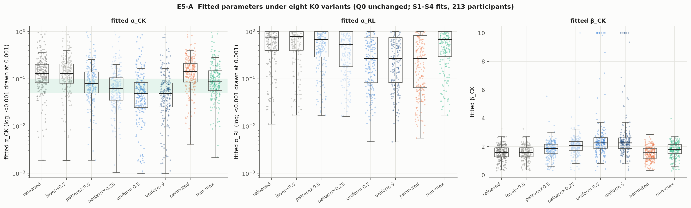
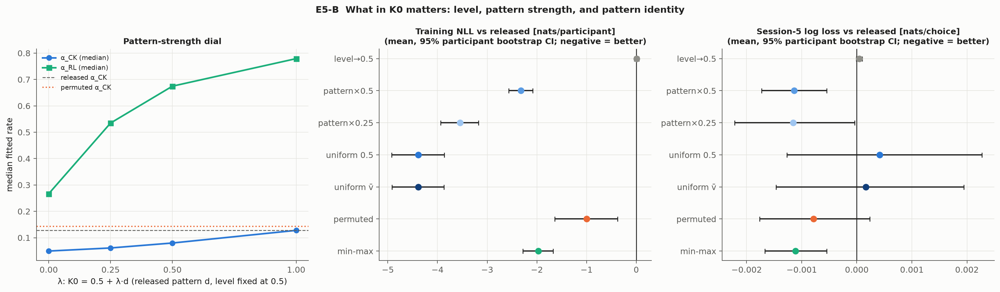
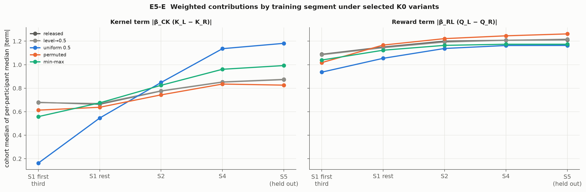
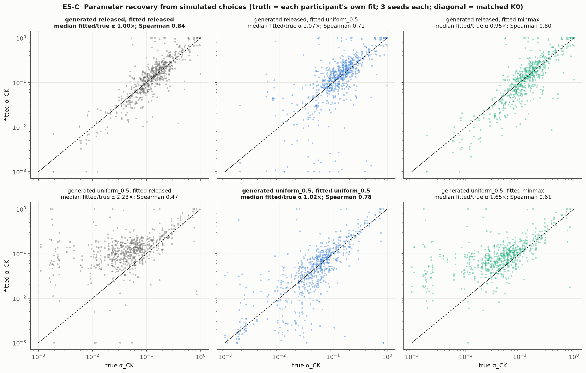
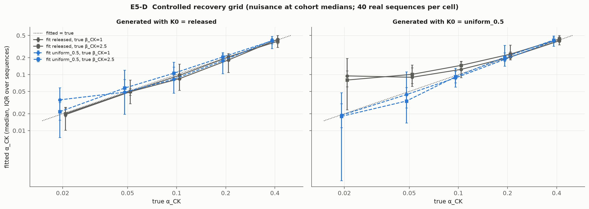

# Experiment 5: choice-kernel initialization mechanisms and parameter recovery

Authors' RL+CK (model 19, π = 0, bias fixed at 2.5). Every condition keeps the released reward initialization Q0 and
the original update equations, bounds, objective and optimizer. Fitting uses training sessions 1–4. Session 5 is
**previously inspected** validation, not a prospective test, and no initialization was chosen on it. The final test
was not read. The generated tables are in the appendix below the marker; this section interprets them.

## Plain-language summary (for discussion with Professor Wu)

1. **The authors' fast kernel learning rate is mostly an estimation artifact of their starting values.** The released
   code starts the choice kernel at the same pre-training values as Q, up to about 4.1, while the kernel is a
   0–1 trace of choices. When we simulate people whose kernel starts neutral and fit them with the released start,
   α_CK comes out inflated by a median 2.2×. The model is forced to "wash out" the off-scale start quickly. Real
   participants show the same signature as those simulated people, and not the signature of people who actually
   start from the released values.
2. **The size of the starting differences drives α_CK. Their level and their specific content do not.** Shifting the
   level changes nothing. Shrinking the released pattern lowers α_CK step by step. Shuffling the same values across
   stimuli leaves α_CK as high as the original.
3. **What the starting pattern *contains* drives the reward learning rate instead.** When K0 carries the same
   pre-training preferences as Q0, Q can update quickly (α_RL ≈ 0.76), because the kernel holds a second copy of the
   prior. When that copy is removed or shuffled, Q must keep the prior itself, so α_RL drops to ≈ 0.27.
4. **Predictions barely change, but the interpretation changes a lot.** Every variant predicts session 5 within about
   0.002 nats/choice of the others. Yet the "same" behaviour is described with a kernel half-life of 5 to 14
   presentations, and with the pre-training preference stored either in the reward values or in the kernel. The data
   cannot tell where that prior lives.
5. **Recommended initialization: a uniform kernel (any constant; 0 matches the paper's text).** It respects what the
   kernel means, does not count the pre-training data twice, gives the best training likelihood (4.4 nats better
   than released, with the same number of parameters), and recovers known parameters without bias. On-scale K0 values
   that carry the prior pattern predict session 5 slightly better (by about 0.001–0.002 nats/choice). That hints that
   pre-training preferences persist on their own timescale, which neither the reward rate nor the kernel rate models
   cleanly. This is the next research direction.

## 1. Design

Write the released vector v = v̄·1 + d, where d is the centred stimulus pattern. A stimulus that has been shown n times
retains (1 − α)^n of its initial value, and choice depends on K_L − K_R. K0 therefore enters the logit only through

  β_CK [ (1 − α)^{n_L} K0_L − (1 − α)^{n_R} K0_R ].

A uniform level v̄ matters only when appearance counts differ (n_L ≠ n_R); a unit test checks this algebra. The pattern
d matters from trial 1, with strength proportional to its spread. Released spread has a median of 1.82, whereas
choice-driven K differences are at most 1.

Eight real-data variants (213 participants each, with 200 identical R-seeded starts plus the saved released optimum):

| question | contrast | what is held fixed |
| --- | --- | --- |
| level | `level_shift` (0.5 + d) vs released | pattern and spread |
| spread (pattern strength) | λ dial 0.5 + λd for λ = 1, 0.5, 0.25, 0 | level 0.5, pattern direction |
| pattern identity | `permuted` (v shuffled, no fixed point) vs released | the eight values, hence level and spread |
| uniform level | `uniform_mean` (v̄) vs `uniform_0.5` | no pattern |
| requested rescaling | `minmax` ((v − min)/(max − min)) | ranking; spread forced to 1, level ≈ 0.5 |
| follow-up (§4) | `pretest_choice` (K0 = pretest choice proportions p) | on-scale empirical choice rates |

Confound accounting: no single contrast changes only "scale". The λ dial changes spread while keeping the pattern
direction and the level fixed; `permuted` changes identity while keeping the value distribution fixed; `minmax`
changes spread *and* level at once and its λ differs between participants (1/range), so it is interpreted only as
an intermediate point on the dial.

Parameter recovery (all synthetic choices simulated by the unchanged authors' process on each participant's real
S1–S5 stimulus and reward sequence; human choices are never used as simulated responses):

- **Realistic regime:** 213 participants × 2 generating initializations (released, uniform 0.5) × 3 seeds = 1,278
  datasets. The truth is each participant's own fit under the generating initialization. Each dataset is refitted
  under {released, uniform 0.5, minmax} with 50 random starts.
- **Controlled grid:** true α_CK ∈ {0.02, 0.05, 0.1, 0.2, 0.4} × β_CK ∈ {1, 2.5}, with nuisance parameters at cohort
  medians, on 40 reproducibly chosen sequences per cell, for both generators.
- **Diagnostics for every fit:**
  - a separate fit started at the truth, to detect optimization failure;
  - the likelihood at the truth, which a reported optimum must not exceed;
  - a fixed-α fit at the true α, as a per-dataset identifiability measure;
  - synthetic session-5 loss and probability differences.

## 2. Established empirical findings (real data, S1–S4 fits)

Verification: the released variant reproduces the saved fits (worst deviance difference 1.1e-13; S5 NLL 3.9e-9), and
there were no failed fits.

| variant | median α_CK | median α_RL | median β_CK | Δ train NLL vs released (nats) | Δ S5 loss vs released |
| --- | --- | --- | --- | --- | --- |
| released | 0.129 | 0.764 | 1.59 | — | — |
| level → 0.5 | 0.128 | 0.779 | 1.60 | +0.01 [−0.03, +0.05] | +0.0000 |
| pattern × 0.5 | 0.080 | 0.675 | 1.87 | −2.32 [−2.56, −2.08] | −0.0011 [−0.0017, −0.0006] |
| pattern × 0.25 | 0.061 | 0.535 | 2.10 | −3.54 [−3.93, −3.15] | −0.0012 [−0.0022, −0.0000] |
| uniform 0.5 | 0.049 | 0.267 | 2.26 | −4.39 [−4.91, −3.86] | +0.0004 [−0.0013, +0.0022] |
| uniform v̄ | 0.049 | 0.267 | 2.26 | −4.39 [−4.90, −3.86] | +0.0002 [−0.0015, +0.0019] |
| permuted | 0.142 | 0.271 | 1.56 | −1.00 [−1.64, −0.36] | −0.0008 [−0.0018, +0.0003] |
| min-max | 0.089 | 0.678 | 1.82 | −1.97 [−2.27, −1.67] | −0.0011 [−0.0016, −0.0005] |
| pretest choice p (follow-up) | 0.065 | 0.630 | 2.00 | −3.16 [−3.54, −2.81] | −0.0015 [−0.0024, −0.0006] |

1. **The level is inert.** `level_shift` matches released in every quantity: α_CK median ratio 1.00, training NLL
   +0.01 nats, S5 +0.0000. `uniform_mean` and `uniform_0.5` are indistinguishable. This matches the algebra in §1.
2. **The spread of a structured K0 controls α_CK monotonically.** Along the dial λ = 0, 0.25, 0.5, 1, the median α_CK
   is 0.049, 0.061, 0.080, 0.128 and training NLL worsens by 0, 0.84, 2.06, 4.40 nats relative to uniform. α_CK falls
   for 203/213 participants at λ = 0.5 and at λ = 0.25. Most of the session-1 penalty E3 found comes from this
   (S1 loss −0.017 at λ = 0 vs −0.008 at λ = 0.5).
3. **The pattern's identity does not control α_CK, but it does control α_RL.** `permuted` keeps the released
   values, and α_CK stays at released levels (median ratio 1.03; 103 participants decrease, 110 increase), while
   α_RL falls to 0.271, the uniform value. The interaction is therefore clean:
   - an off-scale spread inflates α_CK, whatever its content;
   - a K0 pattern that duplicates the prior in Q0 inflates α_RL, by making a second copy of the prior.

   The released initialization does both.
4. **The released initialization fits training worst of all eight variants.** It is the training-likelihood winner
   for 5/213 participants, against 136 for the two uniform variants combined. That the permuted (noise) pattern
   fits better than the released pattern (−1.0 nats) shows that duplicating the prior across Q and K is costly in
   itself, beyond the off-scale spread.
5. **Session-5 prediction is robust.** All variants lie within about 0.002 nats/choice of released. On-scale variants
   that carry the prior pattern (pattern × 0.5 / 0.25, min-max, pretest choice) are slightly better than released, by
   0.0011–0.0015 with CIs excluding 0, and better than uniform (pretest choice vs uniform −0.0019 [−0.0033, −0.0008]).
   They are also 0.8–2.4 nats *worse* than uniform in training. This is a small, previously inspected,
   validation-only difference and was not used to select anything.

## 3. Synthetic results (parameter recovery)

**Matched initializations recover α_CK without bias.**
- Released → released: median fitted/true ratio 1.00, Spearman 0.84.
- Uniform → uniform: 1.02, Spearman 0.78.
- The true α lies within 1 nat of the optimum in 534/639 and 539/639 datasets.
- The remaining scatter is finite-sample variability. It has the same size as the E3 near-optimal ranges, which
  corroborates E3's "constrained but not precise" verdict.

**Initialization mismatch is asymmetric.**
- **Behaviour from a neutral start, fitted with the released start:**
  - α_CK is inflated by a median 2.23× (538/639 over, 69 under); Spearman with the truth drops to 0.47.
  - β_CK is under-estimated by a median of 0.54.
  - The true α is *rejected*: it lies within 1 nat in only 224/639 datasets (median ΔNLL 2.15 nats).
  - This is a confident estimation bias, not weak identification.
  - The grid locates it: the released fit imposes a floor near α ≈ 0.08–0.10 when the true α is 0.02–0.05 (for
    true β_CK = 2.5 and α = 0.02, the truth is within 1 nat in 2/40 sequences). The bias fades for α ≥ 0.2, where the
    off-scale start is washed out quickly anyway. It is larger for larger β_CK, which amplifies the start term.
  - Min-max is a milder version of the same thing (1.65×).
- **Behaviour from the released start, fitted with a uniform start:**
  - α_CK is roughly preserved (1.07×).
  - α_RL absorbs the mismatch, under-estimated by a median 0.29, as Q takes over the prior the kernel would have
    held.
  - The cost is concentrated in early session 1 (S1-early loss +0.019 vs the matched fit) and is small elsewhere.

**Optimization was not the cause.** In 3,834 recovery fits, a start at the truth beat the 50-start optimum by more
than 1e-6 deviance 3 times, and once the truth start itself failed to converge (recorded, not dropped). The likelihood
at the truth never beat the reported optimum. In the controlled grid, 0 of 800 fits had such failures.

**Different parameters can predict alike.**
- Mismatched and matched fits of the same synthetic data differ in α_RL by up to 0.29 (median), yet their S5
  predictions differ by a median |ΔP| of 0.007 (released → uniform). The S5 loss difference has median +0.0002.
- The reverse direction costs more (uniform → released: |ΔP| 0.026, S5 +0.0025).

**Which generator looks like the humans?** We compare the real released-vs-uniform contrasts with the same contrasts
in each simulated population (participant-level medians):

| quantity | real data | simulated from uniform K0 | simulated from released K0 |
| --- | --- | --- | --- |
| log(α_CK released / α_CK uniform) | **0.91** | **0.85** | −0.01 |
| α_RL released − α_RL uniform | 0.10 | 0.12 | 0.22 |
| training loss released − uniform (nats/choice) | **+0.0061** | **+0.0053** | −0.0016 |
| share of participants where released fits better | **10%** | **3%** | 84% |

The real data match the neutral-start population on all four quantities and contradict the released-start population
on α and likelihood. The simulated truths are the participants' own fits, so this is a posterior-predictive check
rather than an independent test, but the two generators make opposite predictions, and only one matches.

## 4. Follow-up: a semantically matched informative start (exploratory)

The kernel is a running average of choice indicators. The pretest provides each participant's empirical choice
proportions p, which are on exactly that scale. K0 = p has α_CK median 0.065 (half-life ≈ 10), α_RL 0.630, a training
NLL 1.22 nats worse than uniform and 3.16 better than released, and the best S5 loss of all variants (−0.0019 vs
uniform). Centring p at 0.5 changes nothing, which again confirms that the level is inert. However, p already enters
Q0, since Q0 averages ratings and pretest proportions. So K0 = p still double-counts the pretest choices, and its high
α_RL shows the same duplication signature as released. It is a candidate, not a principled default.

## 5. Answers

1. **What drives the α shift?** The magnitude (spread) of a non-uniform K0 on an off-scale range. Shrinking the
   pattern lowers α_CK monotonically, while preserving the spread but shuffling the pattern does not. The level plays
   no role. Pattern identity interacts through α_RL, not α_CK. These effects are isolated by controlled contrasts. The
   one remaining confound is that spread and how strongly K0 differences compete with choice-driven differences are
   the same thing in this model, so "scale" cannot be separated further.
2. **Is estimation biased?** Yes, and asymmetrically. Fitting the released start to neutral-start behaviour inflates
   α_CK about 2.2× with high confidence, especially for slow true kernels. Fitting a uniform start to released-start
   behaviour shifts the error into α_RL. Matched fits are unbiased. This is not optimization failure, and it is not
   mere non-identifiability: the bias rejects the truth.
3. **Are predictions robust?** Mostly. Session-5 differences are ≤ 0.002 nats/choice on average. Individual
   participants move more: E4 found 91/213 beyond ±0.005, in both directions.
4. **What happens to interpretation?** It is not robust. The same behaviour supports α_CK half-lives of about 5–14
   presentations and α_RL of 0.27–0.78, depending on where the pre-training preference is stored. That storage
   location is not identified by these data.
5. **Best-justified initialization:** a uniform K0 (0 or 0.5; equivalent here). The reasons:
   - semantics: K is a choice trace in [0, 1], with no pre-training choice history assumed;
   - no double counting of the pretest data already in Q0;
   - the paper's own description (K0 = 0);
   - the best training likelihood;
   - unbiased recovery under the matched model;
   - the real data match the neutral-start population.

   Report α_CK from the released start only with the caveat that it is inflated.
6. **What next?** The evidence does not call for a new kernel update rule: with a sensible start, a single timescale
   suffices (E4 removed the S1 split). It points at the **representation of pre-training preference**. The model can
   store it only in Q0, where its persistence is tied to α_RL, or by duplicating it in K0. The small, consistent S5
   advantage of on-scale prior-carrying starts suggests that the prior persists on its own timescale.

## 6. Unresolved hypotheses and limitations

- **H5a (next experiment):** pre-training preference decays on a timescale separate from reward learning. Proposed
  model: uniform K0, Q0 = 0 (or a common value), plus an explicit prior term β_P (v_L − v_R)·(1 − α_P)^{t}, where t
  counts presentations. This adds two parameters, so it must be validated by parameter recovery before being compared
  on S5 under a pre-declared criterion. It is not implemented here.
- Pretest choice proportions are a proxy for prior choice rates. The pretest context differs from training.
- The synthetic truths come from fits to the same people (posterior-predictive). The grid uses designed truths but
  only 40 sequences per cell.
- `permuted` uses one deterministic permutation per participant. Cohort averages are robust, but individual
  permuted fits are not.
- Session 5 has been inspected repeatedly. Every S5 difference here is small and descriptive.
- Nothing here bears on the final test, which was not read.

## Reproduction

`.venv/bin/python scripts/run_ck_init_mechanisms.py` runs the phases real, synthetic, grid and follow-up with cached
per-participant results in `data/derived/experiment5_ck_init_mechanisms/`. A cold run takes about 26 minutes on 4 workers.
The synthetic phase was resumed after a recorded truth-start convergence failure became non-fatal, so its compute
log covers only the 120 participants fitted after the resume. Use `--participant ...` for a pilot. Tests: `tests/test_ck_init_mechanisms.py`.

<!-- Reviewed interpretation -->

## Appendix: generated results

Verification: released-K0 refit vs saved fits, worst deviance difference 1.1e-13; worst S5 NLL difference 3.9e-09. 213/213 participants analysed (excluded: none). Compute: real 702 s; synthetic 265 s; grid 217 s; followup 186 s (4 workers).

### A1. Fitted parameters by K0 variant

| variant | K0 | K0 level (median) | K0 spread (median) | median α_CK [IQR] | half-life | α_CK < 0.01 | median α_RL | α_RL at bound | median β_CK | median β_RL | failed starts | median starts reaching best |
| --- | --- | --- | --- | --- | --- | --- | --- | --- | --- | --- | --- | --- |
| released | v (authors; level v̄, pattern d, spread ≈ 1.8) | 1.09 | 1.82 | 0.129 [0.082–0.204] | 5.0 | 6 | 0.764 | 82 | 1.59 | 1.21 | 32 | 142 |
| level_shift | 0.5 + d (same pattern and spread, level 0.5) | 0.50 | 1.82 | 0.128 [0.081–0.206] | 5.1 | 6 | 0.779 | 83 | 1.60 | 1.22 | 13 | 142 |
| shrink_0.5 | 0.5 + 0.5·d (same pattern, half spread) | 0.50 | 0.91 | 0.080 [0.050–0.139] | 8.3 | 5 | 0.675 | 73 | 1.87 | 1.17 | 7 | 140 |
| shrink_0.25 | 0.5 + 0.25·d (same pattern, quarter spread) | 0.50 | 0.46 | 0.061 [0.035–0.105] | 11.0 | 12 | 0.535 | 62 | 2.10 | 1.16 | 3 | 140 |
| uniform_0.5 | 0.5 for all (no pattern; = E4 C1) | 0.50 | 0.00 | 0.049 [0.025–0.083] | 13.7 | 24 | 0.267 | 43 | 2.26 | 1.16 | 19 | 116 |
| uniform_mean | v̄ for all (own level, no pattern) | 1.09 | 0.00 | 0.049 [0.025–0.081] | 13.8 | 22 | 0.267 | 43 | 2.26 | 1.17 | 11 | 118 |
| permuted | v shuffled across stimuli (same values, pattern destroyed) | 1.09 | 1.82 | 0.142 [0.085–0.212] | 4.5 | 3 | 0.271 | 46 | 1.56 | 1.26 | 11 | 142 |
| minmax | (v − min)/(max − min) (rank-preserving, in [0,1]) | 0.49 | 1.00 | 0.089 [0.056–0.147] | 7.4 | 4 | 0.678 | 71 | 1.82 | 1.17 | 7 | 139 |

### A2. Paired contrasts (participant-weighted mean [95% bootstrap CI])

| contrast | log α_CK ratio | median ratio | α_CK ↓ / ↑ | Δ α_RL | Δ β_CK | Δ train NLL (nats) | Δ S1 loss | Δ S2–S4 loss | Δ S5 loss |
| --- | --- | --- | --- | --- | --- | --- | --- | --- | --- |
| level_shift vs released | -0.01 [-0.02, +0.01] | 1.00× | 117 / 93 | +0.005 [-0.002, +0.016] | +0.00 [-0.00, +0.01] | +0.01 [-0.04, +0.06] | +0.0001 [-0.0002, +0.0004] | -0.0000 [-0.0000, +0.0000] | +0.0000 [-0.0000, +0.0001] |
| shrink_0.5 vs released | -0.39 [-0.45, -0.34] | 0.70× | 203 / 9 | -0.057 [-0.082, -0.033] | +0.27 [+0.24, +0.31] | -2.32 [-2.57, -2.08] | -0.0084 [-0.0095, -0.0074] | -0.0023 [-0.0026, -0.0020] | -0.0011 [-0.0017, -0.0005] |
| shrink_0.25 vs released | -0.72 [-0.80, -0.64] | 0.53× | 203 / 9 | -0.120 [-0.155, -0.087] | +0.53 [+0.45, +0.63] | -3.54 [-3.94, -3.17] | -0.0135 [-0.0151, -0.0118] | -0.0033 [-0.0038, -0.0028] | -0.0012 [-0.0022, -0.0000] |
| uniform_0.5 vs released | -1.08 [-1.26, -0.90] | 0.40× | 192 / 21 | -0.256 [-0.301, -0.211] | +1.25 [+0.97, +1.57] | -4.39 [-4.92, -3.87] | -0.0172 [-0.0195, -0.0148] | -0.0039 [-0.0045, -0.0033] | +0.0004 [-0.0013, +0.0023] |
| uniform_mean vs released | -1.04 [-1.22, -0.88] | 0.41× | 194 / 19 | -0.257 [-0.302, -0.211] | +1.12 [+0.88, +1.41] | -4.39 [-4.91, -3.87] | -0.0173 [-0.0196, -0.0149] | -0.0039 [-0.0045, -0.0033] | +0.0002 [-0.0015, +0.0019] |
| permuted vs released | +0.03 [-0.12, +0.17] | 1.03× | 103 / 110 | -0.251 [-0.299, -0.205] | -0.03 [-0.07, +0.01] | -1.00 [-1.64, -0.37] | -0.0041 [-0.0070, -0.0013] | -0.0008 [-0.0015, -0.0002] | -0.0008 [-0.0018, +0.0002] |
| minmax vs released | -0.32 [-0.37, -0.26] | 0.76× | 188 / 24 | -0.053 [-0.080, -0.027] | +0.21 [+0.17, +0.24] | -1.97 [-2.28, -1.67] | -0.0073 [-0.0086, -0.0060] | -0.0019 [-0.0022, -0.0016] | -0.0011 [-0.0017, -0.0005] |
| released vs uniform_0.5 | +1.08 [+0.90, +1.26] | 2.48× | 21 / 192 | +0.256 [+0.211, +0.301] | -1.25 [-1.57, -0.97] | +4.39 [+3.87, +4.92] | +0.0172 [+0.0148, +0.0195] | +0.0039 [+0.0033, +0.0045] | -0.0004 [-0.0023, +0.0013] |
| level_shift vs uniform_0.5 | +1.07 [+0.89, +1.26] | 2.46× | 22 / 191 | +0.261 [+0.215, +0.307] | -1.25 [-1.57, -0.97] | +4.40 [+3.88, +4.93] | +0.0173 [+0.0149, +0.0197] | +0.0039 [+0.0033, +0.0045] | -0.0004 [-0.0022, +0.0013] |
| shrink_0.5 vs uniform_0.5 | +0.68 [+0.52, +0.85] | 1.62× | 30 / 183 | +0.199 [+0.160, +0.239] | -0.98 [-1.30, -0.70] | +2.06 [+1.73, +2.41] | +0.0088 [+0.0071, +0.0104] | +0.0016 [+0.0012, +0.0020] | -0.0016 [-0.0031, -0.0002] |
| shrink_0.25 vs uniform_0.5 | +0.35 [+0.21, +0.50] | 1.25× | 46 / 167 | +0.136 [+0.105, +0.170] | -0.72 [-1.04, -0.43] | +0.84 [+0.62, +1.06] | +0.0037 [+0.0026, +0.0048] | +0.0006 [+0.0003, +0.0009] | -0.0016 [-0.0028, -0.0004] |
| uniform_mean vs uniform_0.5 | +0.03 [+0.01, +0.05] | 1.01× | 89 / 124 | -0.001 [-0.005, +0.002] | -0.13 [-0.23, -0.05] | +0.00 [-0.04, +0.05] | -0.0001 [-0.0004, +0.0002] | +0.0000 [-0.0000, +0.0001] | -0.0003 [-0.0004, -0.0001] |
| permuted vs uniform_0.5 | +1.10 [+0.94, +1.27] | 2.50× | 21 / 192 | +0.005 [-0.025, +0.034] | -1.28 [-1.60, -1.00] | +3.39 [+2.81, +3.96] | +0.0131 [+0.0106, +0.0155] | +0.0031 [+0.0024, +0.0038] | -0.0012 [-0.0030, +0.0005] |
| minmax vs uniform_0.5 | +0.76 [+0.60, +0.93] | 1.70× | 27 / 186 | +0.203 [+0.165, +0.244] | -1.04 [-1.36, -0.76] | +2.42 [+2.05, +2.80] | +0.0099 [+0.0081, +0.0116] | +0.0020 [+0.0016, +0.0025] | -0.0015 [-0.0032, -0.0001] |

Training-likelihood winner per participant (descriptive; equal parameter counts): {'released': 5, 'level_shift': 0, 'shrink_0.5': 10, 'shrink_0.25': 27, 'uniform_0.5': 68, 'uniform_mean': 68, 'permuted': 31, 'minmax': 4}.

### A3. Weighted contributions (cohort median of per-participant median |term|)

| variant | first 20 |z_K| | first 20 |z_Q| | S1 early |z_K| | S2 |z_K| | S5 |z_K| | S1 early |z_Q| | S5 |z_Q| |
| --- | --- | --- | --- | --- | --- | --- | --- |
| released | 0.91 | 1.05 | 0.68 | 0.78 | 0.87 | 1.09 | 1.21 |
| level_shift | 0.90 | 1.05 | 0.68 | 0.78 | 0.88 | 1.08 | 1.22 |
| shrink_0.5 | 0.60 | 0.99 | 0.51 | 0.84 | 1.02 | 1.02 | 1.17 |
| shrink_0.25 | 0.40 | 0.96 | 0.38 | 0.87 | 1.13 | 1.00 | 1.16 |
| uniform_0.5 | 0.10 | 0.87 | 0.16 | 0.85 | 1.18 | 0.94 | 1.16 |
| uniform_mean | 0.12 | 0.87 | 0.17 | 0.84 | 1.17 | 0.94 | 1.17 |
| permuted | 0.81 | 0.96 | 0.61 | 0.74 | 0.83 | 1.02 | 1.26 |
| minmax | 0.65 | 0.99 | 0.56 | 0.82 | 0.99 | 1.04 | 1.17 |

### A4. Parameter recovery, realistic regime

| generated → fitted | datasets | median fitted/true α_CK | α over / under (>10%) | Spearman(true, fitted) | median error α_RL | median error β_CK | optimization failures | truth beats fit | true α within 1 nat | median S5 loss − truth | median S5 |ΔP| vs truth |
| --- | --- | --- | --- | --- | --- | --- | --- | --- | --- | --- | --- |
| released->released | 639 | 1.00× | 251 / 249 | 0.84 | -0.009 | -0.02 | 0 | 0 | 534/639 | +0.0014 | 0.018 |
| released->uniform_0.5 | 639 | 1.07× | 301 / 233 | 0.71 | -0.288 | +0.01 | 0 | 0 | 513/639 | +0.0021 | 0.020 |
| released->minmax | 639 | 0.95× | 224 / 292 | 0.80 | -0.060 | +0.05 | 0 | 0 | 520/639 | +0.0017 | 0.018 |
| uniform_0.5->released | 639 | 2.23× | 538 / 69 | 0.47 | +0.035 | -0.54 | 1 | 0 | 224/639 | +0.0052 | 0.032 |
| uniform_0.5->uniform_0.5 | 639 | 1.02× | 273 / 268 | 0.78 | -0.002 | +0.02 | 1 | 0 | 539/639 | +0.0020 | 0.018 |
| uniform_0.5->minmax | 639 | 1.65× | 474 / 97 | 0.61 | +0.025 | -0.33 | 1 | 0 | 334/639 | +0.0034 | 0.023 |

| mismatch | Δ log α vs matched fit (participant mean [CI]) | median S1-early loss − matched | median train loss − matched | median S5 loss − matched | median S5 |ΔP| vs matched |
| --- | --- | --- | --- | --- | --- |
| released->uniform_0.5 | -0.02 [-0.11, +0.06] | +0.0187 | +0.0017 | +0.0002 | 0.007 |
| released->minmax | -0.09 [-0.12, -0.06] | +0.0018 | +0.0001 | +0.0000 | 0.003 |
| uniform_0.5->released | +1.08 [+0.94, +1.22] | +0.0303 | +0.0049 | +0.0025 | 0.026 |
| uniform_0.5->minmax | +0.80 [+0.68, +0.93] | +0.0157 | +0.0023 | +0.0010 | 0.016 |

### A5. Controlled recovery grid (median fitted α_CK [IQR]; 40 sequences per cell)

| generator | true α | true β_CK | fit released | fit uniform 0.5 | true α within 1 nat (rel / uni) | opt. failures (rel / uni) | median α_RL (rel / uni) | train loss released − uniform |
| --- | --- | --- | --- | --- | --- | --- | --- | --- |
| released | 0.02 | 1 | 0.019 [0.010–0.026] | 0.035 [0.008–0.058] | 28 / 36 | 0 / 0 | 0.78 / 0.16 | -0.0060 |
| released | 0.02 | 2.5 | 0.020 [0.018–0.025] | 0.022 [0.015–0.032] | 29 / 30 | 0 / 0 | 0.63 / 0.02 | -0.0086 |
| released | 0.05 | 1 | 0.050 [0.030–0.080] | 0.048 [0.020–0.120] | 31 / 34 | 0 / 0 | 0.67 / 0.29 | -0.0017 |
| released | 0.05 | 2.5 | 0.050 [0.043–0.056] | 0.057 [0.049–0.081] | 34 / 30 | 0 / 0 | 0.59 / 0.05 | -0.0043 |
| released | 0.1 | 1 | 0.084 [0.052–0.155] | 0.083 [0.046–0.166] | 33 / 34 | 0 / 0 | 0.69 / 0.34 | -0.0010 |
| released | 0.1 | 2.5 | 0.097 [0.082–0.116] | 0.106 [0.083–0.137] | 31 / 32 | 0 / 0 | 0.66 / 0.12 | -0.0032 |
| released | 0.2 | 1 | 0.183 [0.109–0.227] | 0.177 [0.104–0.248] | 30 / 32 | 0 / 0 | 0.64 / 0.47 | -0.0002 |
| released | 0.2 | 2.5 | 0.207 [0.177–0.239] | 0.207 [0.179–0.234] | 36 / 36 | 0 / 0 | 0.54 / 0.26 | -0.0012 |
| released | 0.4 | 1 | 0.427 [0.306–0.502] | 0.408 [0.292–0.482] | 31 / 30 | 0 / 0 | 0.57 / 0.49 | -0.0004 |
| released | 0.4 | 2.5 | 0.394 [0.358–0.437] | 0.401 [0.353–0.440] | 30 / 31 | 0 / 0 | 0.59 / 0.37 | -0.0010 |
| uniform_0.5 | 0.02 | 1 | 0.095 [0.024–0.195] | 0.019 [0.001–0.048] | 21 / 37 | 0 / 0 | 0.40 / 0.31 | +0.0009 |
| uniform_0.5 | 0.02 | 2.5 | 0.080 [0.060–0.117] | 0.018 [0.011–0.030] | 2 / 35 | 0 / 0 | 0.62 / 0.26 | +0.0070 |
| uniform_0.5 | 0.05 | 1 | 0.090 [0.062–0.149] | 0.044 [0.014–0.113] | 26 / 31 | 0 / 0 | 0.30 / 0.23 | +0.0013 |
| uniform_0.5 | 0.05 | 2.5 | 0.101 [0.070–0.133] | 0.034 [0.026–0.059] | 14 / 34 | 0 / 0 | 0.60 / 0.26 | +0.0079 |
| uniform_0.5 | 0.1 | 1 | 0.124 [0.088–0.170] | 0.087 [0.060–0.114] | 29 / 30 | 0 / 0 | 0.48 / 0.29 | +0.0008 |
| uniform_0.5 | 0.1 | 2.5 | 0.146 [0.123–0.173] | 0.091 [0.071–0.130] | 20 / 30 | 0 / 0 | 0.58 / 0.31 | +0.0047 |
| uniform_0.5 | 0.2 | 1 | 0.206 [0.185–0.337] | 0.186 [0.142–0.333] | 35 / 30 | 0 / 0 | 0.46 / 0.36 | +0.0007 |
| uniform_0.5 | 0.2 | 2.5 | 0.232 [0.184–0.254] | 0.204 [0.172–0.245] | 34 / 37 | 0 / 0 | 0.56 / 0.25 | +0.0028 |
| uniform_0.5 | 0.4 | 1 | 0.402 [0.341–0.503] | 0.400 [0.320–0.493] | 35 / 34 | 0 / 0 | 0.33 / 0.28 | +0.0006 |
| uniform_0.5 | 0.4 | 2.5 | 0.432 [0.378–0.474] | 0.414 [0.373–0.470] | 34 / 34 | 0 / 0 | 0.49 / 0.25 | +0.0021 |

### Figures

